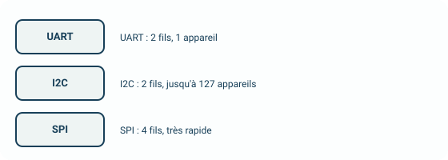
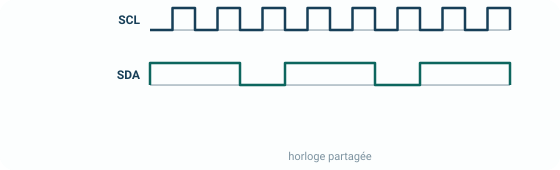

Pour dialoguer avec un écran, un capteur ou une carte mémoire, l'ESP32 dispose de trois liaisons série. L'UART du module M5 relie deux appareils ; l'**I2C** et le **SPI** en relient plusieurs sur les mêmes fils.

## Asynchrone ou synchrone

L'UART est **asynchrone** : les deux côtés se sont mis d'accord à l'avance sur la vitesse. L'I2C et le SPI sont **synchrones** : un fil d'**horloge**, commandé par l'ESP32, dit au récepteur à quel instant lire chaque bit.

L'ESP32 est le **maître** : il fournit l'horloge et choisit avec quel appareil il parle. Les capteurs et l'écran sont des **esclaves** (on dit aussi cibles) : ils répondent quand on les interroge.

## Choisir un bus

| | I2C | SPI |
|---|---|---|
| fils | 2 : SDA (données), SCL (horloge) | 4 : MOSI, MISO, SCK, plus un CS par appareil |
| choix de l'appareil | une **adresse** dans le message | une ligne **CS** par appareil |
| vitesse courante | 100 ou 400 kbit/s | plusieurs Mbit/s |
| exemples | écran OLED, capteur BME280 | carte microSD, écran rapide |

Règle pratique : l'I2C pour les petits capteurs et les petits écrans, peu gourmands ; le SPI quand il faut beaucoup de débit, comme une carte mémoire.

## À retenir

- I2C et SPI sont synchrones : l'ESP32, maître, fournit l'horloge.
- I2C : 2 fils, appareils choisis par adresse. SPI : 4 fils, un CS par appareil, plus rapide.
