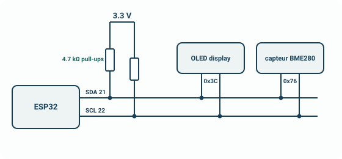
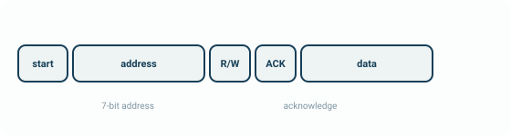
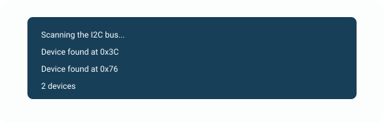

The I2C bus has only **two wires**, shared by every device: **SDA** (data) on GPIO 21 and **SCL** (clock) on GPIO 22. Each device has a 7-bit **address**.



## The pull-up resistors

On an I2C bus, a device never drives a line high: it can only **pull it to 0**. Two **pull-up resistors** to 3.3 V (often 4.7 kΩ) bring SDA and SCL back high the rest of the time. The OLED and BME280 modules of the kit already carry theirs: do not add more.

## An I2C frame



The controller sends the **address**; only the device that recognises it **acknowledges** by pulling SDA to 0. With 7 bits there are 2⁷ = 128 addresses, 127 of them usable. Common examples: SSD1306 OLED display at 0x3C, BME280 sensor at 0x76 or 0x77.

## The I2C scanner

The first program to run with a new module: it tries every address and shows those that reply.

```cpp
#include <Arduino.h>
#include <Wire.h>

// I2C bus: SDA on GPIO 21, SCL on GPIO 22
const uint8_t SDA_PIN = 21;
const uint8_t SCL_PIN = 22;

void setup() {
  Serial.begin(115200);
  Wire.begin(SDA_PIN, SCL_PIN);
  delay(1000);
  Serial.println("Scanning the I2C bus...");
  uint8_t found = 0;
  for (uint8_t address = 1; address < 127; address++) {
    Wire.beginTransmission(address);
    // 0: a device acknowledged its address
    if (Wire.endTransmission() == 0) {
      Serial.printf("Device found at 0x%02X\n", address);
      found++;
    }
  }
  Serial.printf("%u device(s)\n", found);
}

void loop() {
}
```



`Wire.endTransmission()` returns 0 when the device acknowledged. If nothing is found: check the 3.3 V supply, the ground, and that SDA and SCL are not swapped.

## Key points

- SDA on GPIO 21, SCL on GPIO 22, two pull-up resistors to 3.3 V.
- Each device has a 7-bit address; two devices on the bus never share one.
- The I2C scanner finds the address of an unknown module.
