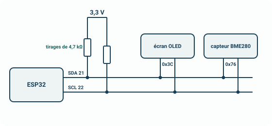
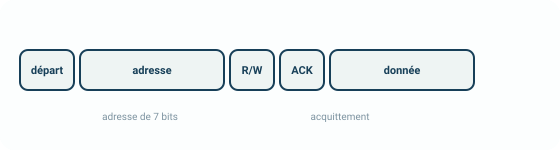

Le bus I2C n'a que **deux fils**, partagés par tous les appareils : **SDA** (les données) sur GPIO 21 et **SCL** (l'horloge) sur GPIO 22. Chaque appareil a une **adresse** de 7 bits.



## Les résistances de tirage

Sur un bus I2C, un appareil ne fait jamais monter une ligne : il ne peut que la **tirer vers 0**. Deux **résistances de tirage** vers 3,3 V (souvent 4,7 kΩ) ramènent SDA et SCL au niveau haut le reste du temps. Les modules OLED et BME280 du kit portent déjà les leurs : on ne les rajoute pas.

## Une trame I2C



Le maître envoie l'**adresse** ; seul l'appareil qui la reconnaît **acquitte** en tirant SDA à 0. Avec 7 bits, on dispose de 2⁷ = 128 adresses, dont 127 utilisables. Exemples courants : écran OLED SSD1306 en 0x3C, capteur BME280 en 0x76 ou 0x77.

## Le scanner I2C

Premier programme à lancer avec un nouveau module : il essaie toutes les adresses et affiche celles qui répondent.

```cpp
#include <Arduino.h>
#include <Wire.h>

// Bus I2C : SDA sur GPIO 21, SCL sur GPIO 22
const uint8_t SDA_PIN = 21;
const uint8_t SCL_PIN = 22;

void setup() {
  Serial.begin(115200);
  Wire.begin(SDA_PIN, SCL_PIN);
  delay(1000);
  Serial.println("Recherche sur le bus I2C...");
  uint8_t found = 0;
  for (uint8_t address = 1; address < 127; address++) {
    Wire.beginTransmission(address);
    // 0 : un appareil a acquitté son adresse
    if (Wire.endTransmission() == 0) {
      Serial.printf("Appareil trouvé en 0x%02X\n", address);
      found++;
    }
  }
  Serial.printf("%u appareil(s)\n", found);
}

void loop() {
}
```


`Wire.endTransmission()` renvoie 0 quand l'appareil a acquitté. Si rien n'est trouvé : vérifier l'alimentation en 3,3 V, la masse, et ne pas avoir inversé SDA et SCL.

## À retenir

- SDA sur GPIO 21, SCL sur GPIO 22, deux résistances de tirage vers 3,3 V.
- Chaque appareil a une adresse de 7 bits ; deux appareils du bus n'ont jamais la même.
- Le scanner I2C trouve l'adresse d'un module inconnu.
