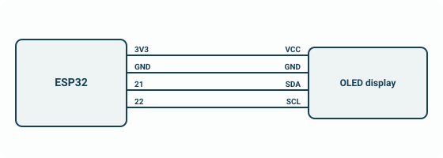
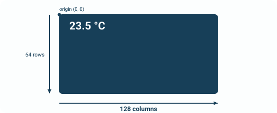

The OLED display of the kit, driven by the **SSD1306** chip, has **128 columns by 64 rows** of pixels. It connects to the I2C bus, at address 0x3C.



## The coordinates



The origin (0, 0) is **at the top left**; x goes from 0 to 127 to the right, y from 0 to 63 downwards.

## The program

Two Adafruit libraries, declared in `lib_deps` of the reference `platformio.ini`, do the work: `Adafruit_SSD1306` for the display, `Adafruit_GFX` for text and shapes.

```cpp
#include <Arduino.h>
#include <Wire.h>
#include <Adafruit_GFX.h>
#include <Adafruit_SSD1306.h>

const uint8_t SCREEN_WIDTH = 128;
const uint8_t SCREEN_HEIGHT = 64;
const uint8_t OLED_ADDRESS = 0x3C;

// -1: the display has no reset pin wired
Adafruit_SSD1306 display(SCREEN_WIDTH, SCREEN_HEIGHT, &Wire, -1);

void setup() {
  Serial.begin(115200);
  Wire.begin(21, 22);
  if (!display.begin(SSD1306_SWITCHCAPVCC, OLED_ADDRESS)) {
    Serial.println("Display not found: check the wiring and the address");
    return;
  }
  display.clearDisplay();
  display.setTextColor(SSD1306_WHITE);
  display.setTextSize(2);
  display.setCursor(0, 0);
  display.println("ESP32");
  display.setTextSize(1);
  display.setCursor(0, 24);
  display.println("Hello!");
  display.drawRect(0, 40, 128, 20, SSD1306_WHITE);
  // Nothing shows before display()
  display.display();
}

void loop() {
}
```

- `display.begin(SSD1306_SWITCHCAPVCC, 0x3C)` starts the display at its address; it returns `false` if the display does not reply.
- `clearDisplay`, `setTextSize`, `setCursor`, `println`, `drawRect` draw into an **image in memory**.
- `display.display()` sends that image to the display: **nothing shows before**.

The whole image weighs 128 × 64 / 8 = 1024 bytes: avoid sending it again at every pass through `loop()`, only when the display changes.

## Key points

- SSD1306: 128 × 64 pixels, address 0x3C, origin at the top left.
- Draw in memory, then `display()` sends the image.
- Refresh the display only when something changes.
