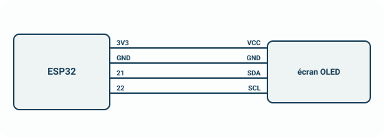
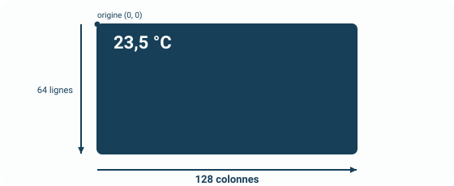

L'écran OLED du kit, piloté par la puce **SSD1306**, compte **128 colonnes sur 64 lignes** de pixels. Il se branche sur le bus I2C, à l'adresse 0x3C.



## Les coordonnées



L'origine (0, 0) est **en haut à gauche** ; x va de 0 à 127 vers la droite, y de 0 à 63 vers le bas.

## Le programme

Deux bibliothèques d'Adafruit, déclarées dans `lib_deps` du `platformio.ini` de référence, font le travail : `Adafruit_SSD1306` pour l'écran, `Adafruit_GFX` pour le texte et les formes.

```cpp
#include <Arduino.h>
#include <Wire.h>
#include <Adafruit_GFX.h>
#include <Adafruit_SSD1306.h>

const uint8_t SCREEN_WIDTH = 128;
const uint8_t SCREEN_HEIGHT = 64;
const uint8_t OLED_ADDRESS = 0x3C;

// -1 : l'écran n'a pas de broche de remise à zéro reliée
Adafruit_SSD1306 display(SCREEN_WIDTH, SCREEN_HEIGHT, &Wire, -1);

void setup() {
  Serial.begin(115200);
  Wire.begin(21, 22);
  if (!display.begin(SSD1306_SWITCHCAPVCC, OLED_ADDRESS)) {
    Serial.println("Écran introuvable : vérifiez le câblage et l'adresse");
    return;
  }
  display.clearDisplay();
  display.setTextColor(SSD1306_WHITE);
  display.setTextSize(2);
  display.setCursor(0, 0);
  display.println("ESP32");
  display.setTextSize(1);
  display.setCursor(0, 24);
  display.println("Bonjour !");
  display.drawRect(0, 40, 128, 20, SSD1306_WHITE);
  // Rien ne s'affiche avant display()
  display.display();
}

void loop() {
}
```

- `display.begin(SSD1306_SWITCHCAPVCC, 0x3C)` démarre l'écran à son adresse ; elle renvoie `false` si l'écran ne répond pas.
- `clearDisplay`, `setTextSize`, `setCursor`, `println`, `drawRect` dessinent dans une **image en mémoire**.
- `display.display()` envoie cette image à l'écran : **rien ne s'affiche avant**.

L'image complète pèse 128 × 64 / 8 = 1 024 octets : on évite de la renvoyer à chaque tour de `loop()`, seulement quand l'affichage change.

## À retenir

- SSD1306 : 128 × 64 pixels, adresse 0x3C, origine en haut à gauche.
- On dessine en mémoire, puis `display()` envoie l'image.
- Rafraîchir l'écran seulement quand quelque chose change.
