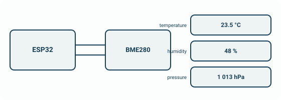
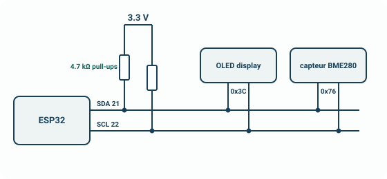

The **BME280** measures temperature, relative humidity and atmospheric pressure. It connects to the **same I2C bus** as the display: same SDA and SCL wires, different address (0x76, or 0x77 depending on the module).



## The program

```cpp
#include <Arduino.h>
#include <Wire.h>
#include <Adafruit_BME280.h>

const uint8_t BME_ADDRESS = 0x76;  // 0x77 on some modules
const uint32_t PERIOD_MS = 2000;

Adafruit_BME280 bme;
uint32_t lastMs = 0;

void setup() {
  Serial.begin(115200);
  Wire.begin(21, 22);
  if (!bme.begin(BME_ADDRESS)) {
    Serial.println("BME280 not found");
  }
}

void loop() {
  uint32_t now = millis();
  if (now - lastMs >= PERIOD_MS) {
    lastMs = now;
    float temperature = bme.readTemperature();      // °C
    float humidity = bme.readHumidity();            // %
    float pressure = bme.readPressure() / 100.0f;   // Pa to hPa
    Serial.printf("T = %.1f °C, H = %.1f %%, P = %.1f hPa\n", temperature, humidity, pressure);
  }
}
```

| Function | Result | Unit |
|---|---|---|
| `readTemperature()` | temperature | °C |
| `readHumidity()` | relative humidity | % |
| `readPressure()` | pressure | Pa (divide by 100 to get hPa) |

Pressure at sea level is about 1013 hPa; it drops by about 12 hPa every 100 m of altitude.

## Two devices on the same bus



The display (0x3C) and the sensor (0x76) share the two wires without getting in each other's way: each replies only to its own address. The scanner of section 2 must find both. If two modules have the same address, most offer a jumper or a solder pad to change it.

## Reading at the right rhythm

The temperature of a room changes slowly: one measurement every 2 s is plenty. The program uses `millis()` (module M4) rather than a `delay`, so that `loop()` stays free.

## Key points

- BME280: temperature (°C), humidity (%), pressure (Pa, or hPa after dividing by 100).
- Same bus as the display, address 0x76 or 0x77.
- Measure at a suitable rhythm, without blocking.
