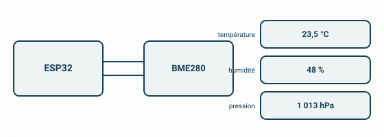
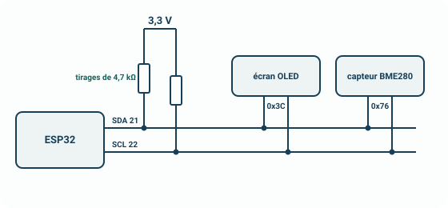

Le **BME280** mesure la température, l'humidité relative et la pression atmosphérique. Il se branche sur le **même bus I2C** que l'écran : mêmes fils SDA et SCL, adresse différente (0x76, ou 0x77 selon le module).



## Le programme

```cpp
#include <Arduino.h>
#include <Wire.h>
#include <Adafruit_BME280.h>

const uint8_t BME_ADDRESS = 0x76;  // 0x77 sur certains modules
const uint32_t PERIOD_MS = 2000;

Adafruit_BME280 bme;
uint32_t lastMs = 0;

void setup() {
  Serial.begin(115200);
  Wire.begin(21, 22);
  if (!bme.begin(BME_ADDRESS)) {
    Serial.println("BME280 introuvable");
  }
}

void loop() {
  uint32_t now = millis();
  if (now - lastMs >= PERIOD_MS) {
    lastMs = now;
    float temperature = bme.readTemperature();      // °C
    float humidity = bme.readHumidity();            // %
    float pressure = bme.readPressure() / 100.0f;   // Pa vers hPa
    Serial.printf("T = %.1f °C, H = %.1f %%, P = %.1f hPa\n", temperature, humidity, pressure);
  }
}
```

| Fonction | Résultat | Unité |
|---|---|---|
| `readTemperature()` | température | °C |
| `readHumidity()` | humidité relative | % |
| `readPressure()` | pression | Pa (diviser par 100 pour obtenir des hPa) |

La pression au niveau de la mer vaut environ 1 013 hPa ; elle baisse d'environ 12 hPa tous les 100 m d'altitude.

## Deux appareils sur le même bus



L'écran (0x3C) et le capteur (0x76) partagent les deux fils sans se gêner : chacun ne répond qu'à son adresse. Le scanner de la section 2 doit trouver les deux. Si deux modules ont la même adresse, la plupart offrent un cavalier ou une soudure pour la changer.

## Lire au bon rythme

La température d'une pièce change lentement : une mesure toutes les 2 s suffit largement. Le programme utilise `millis()` (module M4) plutôt qu'un `delay`, pour que `loop()` reste libre.

## À retenir

- BME280 : température (°C), humidité (%), pression (Pa, ou hPa après division par 100).
- Même bus que l'écran, adresse 0x76 ou 0x77.
- Mesurer à un rythme adapté, sans bloquer.
