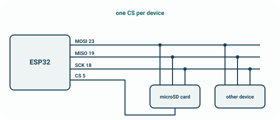
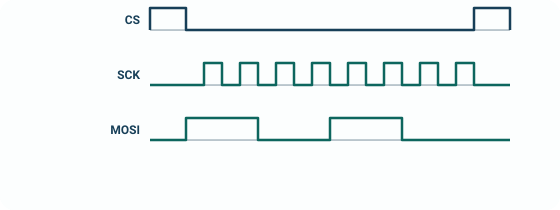

The **SPI** bus exchanges data in both directions at once, on separate wires, and goes much faster than I2C.



## The four wires

| Wire | Role | Default GPIO |
|---|---|---|
| MOSI | data from the controller to the device | 23 |
| MISO | data from the device to the controller | 19 |
| SCK | clock, supplied by the controller | 18 |
| CS | device select, active low | free choice, one per device |

There is no address: to talk to a device, the controller sets **its** CS line to 0; the others, whose CS line stays at 1, ignore the bus.



## In the program

The `SPI` library uses the default pins; only the CS pin has to be chosen:

```cpp
// Default SPI bus: SCK 18, MISO 19, MOSI 23; each device has its CS
const uint8_t SD_CS_PIN = 5;
```

GPIO 5 is a strapping pin (module M1): it is the usual choice for the CS of a microSD card, because its module holds the line high at boot, which suits the chip.

## SPI modes

Depending on the device, the data is read on the rising or falling edge of the clock: these are **modes** 0 to 3. The library of each device (here `SD`) sets the right mode: leave it alone.

## Key points

- SPI: MOSI 23, MISO 19, SCK 18 shared, one CS per device.
- CS at 0 selects the device; no address.
- Faster than I2C, but one more wire per device.
