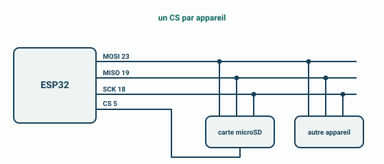
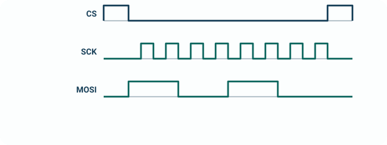

Le bus **SPI** échange les données dans les deux sens en même temps, sur des fils séparés, et va bien plus vite que l'I2C.



## Les quatre fils

| Fil | Rôle | GPIO par défaut |
|---|---|---|
| MOSI | données du maître vers l'appareil | 23 |
| MISO | données de l'appareil vers le maître | 19 |
| SCK | horloge, fournie par le maître | 18 |
| CS | choix de l'appareil, actif au niveau bas | au choix, un par appareil |

Il n'y a pas d'adresse : pour parler à un appareil, le maître met **sa** ligne CS à 0 ; les autres, dont la ligne CS reste à 1, ignorent le bus.



## Dans le programme

La bibliothèque `SPI` utilise les broches par défaut ; seule la broche CS est à choisir :

```cpp
// Bus SPI par défaut : SCK 18, MISO 19, MOSI 23 ; chaque appareil a son CS
const uint8_t SD_CS_PIN = 5;
```

GPIO 5 est une broche de strapping (module M1) : c'est le choix habituel pour le CS d'une carte microSD, car son module tient la ligne au niveau haut au démarrage, ce qui convient à la puce.

## Les modes SPI

Selon l'appareil, les données sont lues sur le front montant ou descendant de l'horloge : ce sont les **modes** 0 à 3. La bibliothèque de chaque appareil (ici `SD`) règle le bon mode : on n'y touche pas.

## À retenir

- SPI : MOSI 23, MISO 19, SCK 18 partagés, un CS par appareil.
- CS à 0 choisit l'appareil ; pas d'adresse.
- Plus rapide que l'I2C, mais un fil de plus par appareil.
