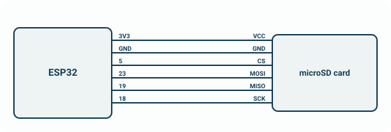

A **microSD card** keeps measurements for months, and you read them later on a computer. The kit module connects to the SPI bus.



The card must be formatted as **FAT32**. Even if the module carries a regulator and accepts 5 V, supply it at 3.3 V from the 3V3 pin: its data lines then stay at the ESP32 level.

## A measurement log

```cpp
#include <Arduino.h>
#include <SPI.h>
#include <SD.h>

// Default SPI bus: SCK 18, MISO 19, MOSI 23; each device has its CS
const uint8_t SD_CS_PIN = 5;
const uint8_t POT_PIN = 34;
const uint32_t PERIOD_MS = 5000;
const char *LOG_PATH = "/journal.csv";

uint32_t lastMs = 0;

void setup() {
  Serial.begin(115200);
  if (!SD.begin(SD_CS_PIN)) {
    Serial.println("microSD card missing or badly wired");
    return;
  }
  if (!SD.exists(LOG_PATH)) {
    File file = SD.open(LOG_PATH, FILE_WRITE);
    file.println("time_ms;voltage_mV");
    file.close();
  }
}

void loop() {
  uint32_t now = millis();
  if (now - lastMs >= PERIOD_MS) {
    lastMs = now;
    // Open for append, write one line, close at once
    File file = SD.open(LOG_PATH, FILE_APPEND);
    if (file) {
      file.printf("%lu;%lu\n", (unsigned long)now, (unsigned long)analogReadMilliVolts(POT_PIN));
      file.close();
    }
  }
}
```

- `SD.begin(SD_CS_PIN)` mounts the card; it returns `false` if the card is missing or badly wired.
- `SD.open(path, FILE_APPEND)` opens the file for **appending**: each line is written at the end. `FILE_WRITE` would have overwritten it.
- `file.close()` finishes the write: a card removed before closing may lose the last lines.

## The CSV format


One line per measurement, values separated by semicolons and a header line: a spreadsheet opens it directly. Numbers are written with a decimal **point**.

## Key points

- microSD over SPI, formatted as FAT32, supplied at 3.3 V.
- `FILE_APPEND` to add, `close()` after each write.
- CSV: one line per measurement, one header line.
