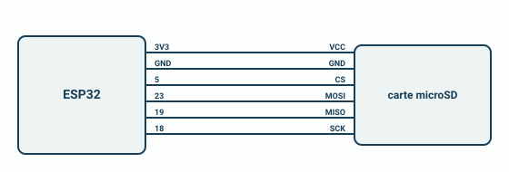
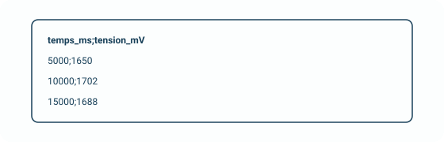

Une **carte microSD** garde des mesures pendant des mois, et on la relit ensuite sur un ordinateur. Le module du kit se branche sur le bus SPI.



La carte doit être formatée en **FAT32**. Si le module porte un régulateur et accepte 5 V, on l'alimente quand même en 3,3 V depuis la broche 3V3 : ses lignes de données restent ainsi au niveau de l'ESP32.

## Un journal de mesures

```cpp
#include <Arduino.h>
#include <SPI.h>
#include <SD.h>

// Bus SPI par défaut : SCK 18, MISO 19, MOSI 23 ; chaque appareil a son CS
const uint8_t SD_CS_PIN = 5;
const uint8_t POT_PIN = 34;
const uint32_t PERIOD_MS = 5000;
const char *LOG_PATH = "/journal.csv";

uint32_t lastMs = 0;

void setup() {
  Serial.begin(115200);
  if (!SD.begin(SD_CS_PIN)) {
    Serial.println("Carte microSD absente ou mal câblée");
    return;
  }
  if (!SD.exists(LOG_PATH)) {
    File file = SD.open(LOG_PATH, FILE_WRITE);
    file.println("temps_ms;tension_mV");
    file.close();
  }
}

void loop() {
  uint32_t now = millis();
  if (now - lastMs >= PERIOD_MS) {
    lastMs = now;
    // Ouvrir en ajout, écrire une ligne, fermer aussitôt
    File file = SD.open(LOG_PATH, FILE_APPEND);
    if (file) {
      file.printf("%lu;%lu\n", (unsigned long)now, (unsigned long)analogReadMilliVolts(POT_PIN));
      file.close();
    }
  }
}
```

- `SD.begin(SD_CS_PIN)` monte la carte ; elle renvoie `false` si la carte est absente ou mal câblée.
- `SD.open(chemin, FILE_APPEND)` ouvre le fichier en **ajout** : chaque ligne s'écrit à la fin. `FILE_WRITE` l'aurait écrasé.
- `file.close()` termine l'écriture : une carte retirée avant la fermeture peut perdre les dernières lignes.

## Le format CSV



Une ligne par mesure, des valeurs séparées par des points-virgules et une ligne d'en-tête : un tableur l'ouvre directement. Les nombres s'écrivent avec un **point** décimal ; le tableur les convertit à l'ouverture.

## À retenir

- microSD en SPI, formatée en FAT32, alimentée en 3,3 V.
- `FILE_APPEND` pour ajouter, `close()` après chaque écriture.
- CSV : une ligne par mesure, une ligne d'en-tête.
