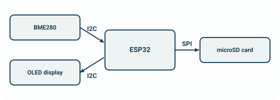

This mini-project brings both buses together: a **measuring station** that shows temperature and humidity on the display and records them on the microSD card every 10 s.

## Goal

Make two I2C devices and one SPI device live together in a single non-blocking program.

## Safety

- Circuit powered by the computer's USB; no circuit in the course goes above **12 V** DC.
- Every module is supplied by the 3V3 pin, never 5 V on an ESP32 pin.
- Wire with the USB cable unplugged; remove the microSD card only with the power off.



## Equipment

| Quantity | Item |
|---|---|
| 1 | ESP32 DevKit board, breadboard and wires |
| 1 | SSD1306 I2C OLED display (0x3C) |
| 1 | BME280 I2C sensor (0x76) |
| 1 | SPI microSD module and a card formatted as FAT32 |
| 1 | multimeter |

## Program

```cpp
#include <Arduino.h>
#include <Wire.h>
#include <SPI.h>
#include <SD.h>
#include <Adafruit_GFX.h>
#include <Adafruit_SSD1306.h>
#include <Adafruit_BME280.h>

const uint8_t SD_CS_PIN = 5;
const uint32_t PERIOD_MS = 10000;
const char *LOG_PATH = "/station.csv";

Adafruit_SSD1306 display(128, 64, &Wire, -1);
Adafruit_BME280 bme;
bool sdReady = false;
uint32_t lastMs = 0;

void showOnScreen(float temperature, float humidity) {
  display.clearDisplay();
  display.setTextSize(2);
  display.setCursor(0, 0);
  display.printf("%.1f C\n", temperature);
  display.printf("%.0f %%\n", humidity);
  display.setTextSize(1);
  display.println(sdReady ? "log: yes" : "log: no");
  display.display();
}

void setup() {
  Serial.begin(115200);
  Wire.begin(21, 22);
  display.begin(SSD1306_SWITCHCAPVCC, 0x3C);
  display.setTextColor(SSD1306_WHITE);
  if (!bme.begin(0x76)) {
    Serial.println("BME280 not found");
  }
  sdReady = SD.begin(SD_CS_PIN);
}

void loop() {
  uint32_t now = millis();
  if (lastMs != 0 && now - lastMs < PERIOD_MS) {
    return;
  }
  lastMs = now;
  float temperature = bme.readTemperature();
  float humidity = bme.readHumidity();
  showOnScreen(temperature, humidity);
  Serial.printf("%lu;%.1f;%.1f\n", (unsigned long)now, temperature, humidity);
  if (sdReady) {
    File file = SD.open(LOG_PATH, FILE_APPEND);
    if (file) {
      file.printf("%lu;%.1f;%.1f\n", (unsigned long)now, temperature, humidity);
      file.close();
    }
  }
}
```

## Full kit variant

1. Wire, then first run the I2C scanner (section 2): it must find 0x3C and 0x76.
2. Upload the station; breathe gently on the sensor and watch the humidity rise.
3. On the oscilloscope, channel 1 on SCL (GPIO 22), channel 2 on SDA (GPIO 21): watch a frame and measure the clock frequency.

## Multimeter-only variant

1. Same circuit; after a few minutes, remove the card with the power off and open `station.csv` on the computer.
2. Measure the voltage of SDA and SCL at rest.

| Measurement | Expected | Measured |
|---|---|---|
| addresses found by the scanner | 0x3C and 0x76 | |
| SDA and SCL at rest | 3.3 V | |
| lines added in 1 min | 6 | |
| temperature shown and recorded | identical | |

## To conclude

Explain why the display and the sensor can share the same SDA and SCL wires without their replies getting mixed up.
