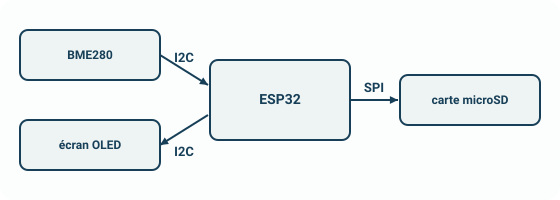

Ce mini-projet réunit les deux bus : une **station de mesure** qui affiche la température et l'humidité sur l'écran et les enregistre sur la carte microSD toutes les 10 s.

## Objectif

Faire cohabiter deux appareils I2C et un appareil SPI dans un même programme non bloquant.

## Sécurité

- Montage alimenté par l'USB de l'ordinateur ; aucun montage de la formation ne dépasse **12 V** en continu.
- Tous les modules sont alimentés par la broche 3V3, jamais en 5 V sur une broche de l'ESP32.
- Câblez câble USB débranché ; retirez la carte microSD seulement hors tension.



## Matériel

| Quantité | Élément |
|---|---|
| 1 | carte DevKit ESP32, plaque d'essai et fils |
| 1 | écran OLED SSD1306 I2C (0x3C) |
| 1 | capteur BME280 I2C (0x76) |
| 1 | module microSD SPI et carte formatée en FAT32 |
| 1 | multimètre |

## Programme

```cpp
#include <Arduino.h>
#include <Wire.h>
#include <SPI.h>
#include <SD.h>
#include <Adafruit_GFX.h>
#include <Adafruit_SSD1306.h>
#include <Adafruit_BME280.h>

const uint8_t SD_CS_PIN = 5;
const uint32_t PERIOD_MS = 10000;
const char *LOG_PATH = "/station.csv";

Adafruit_SSD1306 display(128, 64, &Wire, -1);
Adafruit_BME280 bme;
bool sdReady = false;
uint32_t lastMs = 0;

void showOnScreen(float temperature, float humidity) {
  display.clearDisplay();
  display.setTextSize(2);
  display.setCursor(0, 0);
  display.printf("%.1f C\n", temperature);
  display.printf("%.0f %%\n", humidity);
  display.setTextSize(1);
  display.println(sdReady ? "journal : oui" : "journal : non");
  display.display();
}

void setup() {
  Serial.begin(115200);
  Wire.begin(21, 22);
  display.begin(SSD1306_SWITCHCAPVCC, 0x3C);
  display.setTextColor(SSD1306_WHITE);
  if (!bme.begin(0x76)) {
    Serial.println("BME280 introuvable");
  }
  sdReady = SD.begin(SD_CS_PIN);
}

void loop() {
  uint32_t now = millis();
  if (lastMs != 0 && now - lastMs < PERIOD_MS) {
    return;
  }
  lastMs = now;
  float temperature = bme.readTemperature();
  float humidity = bme.readHumidity();
  showOnScreen(temperature, humidity);
  Serial.printf("%lu;%.1f;%.1f\n", (unsigned long)now, temperature, humidity);
  if (sdReady) {
    File file = SD.open(LOG_PATH, FILE_APPEND);
    if (file) {
      file.printf("%lu;%.1f;%.1f\n", (unsigned long)now, temperature, humidity);
      file.close();
    }
  }
}
```

## Variante kit complet

1. Câblez, lancez d'abord le scanner I2C (section 2) : il doit trouver 0x3C et 0x76.
2. Téléversez la station ; soufflez doucement sur le capteur et regardez l'humidité monter.
3. À l'oscilloscope, voie 1 sur SCL (GPIO 22), voie 2 sur SDA (GPIO 21) : observez une trame et mesurez la fréquence de l'horloge.

## Variante multimètre seul

1. Même montage ; après quelques minutes, retirez la carte hors tension et ouvrez `station.csv` sur l'ordinateur.
2. Mesurez la tension de SDA et de SCL au repos.

| Mesure | Attendue | Relevée |
|---|---|---|
| adresses trouvées par le scanner | 0x3C et 0x76 | |
| SDA et SCL au repos | 3,3 V | |
| lignes ajoutées en 1 min | 6 | |
| température affichée et notée | identiques | |

## Pour conclure

Expliquez pourquoi l'écran et le capteur peuvent partager les mêmes fils SDA et SCL sans que leurs réponses se mélangent.
