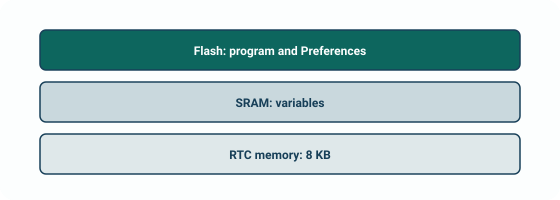
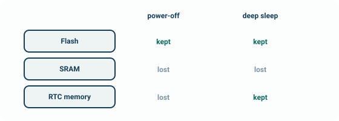

Module M1 introduced the ESP32 memories. For a device that must **remember** (a setting, a counter, a maximum), you need to know what each one keeps, and when.

- **Flash**: it holds the program and a small storage area, the **NVS**, where the `Preferences` library stores settings. It keeps everything, even without power.
- **SRAM**: ordinary variables. It loses everything at power-off, and also in **deep sleep**, because the chip is almost switched off there.
- **RTC memory**: 8 KB that stay powered during deep sleep, together with the RTC clock. It loses everything at power-off.

## Choosing a memory

| Need | Memory | Tool |
|---|---|---|
| a working value, harmlessly lost at restart | SRAM | ordinary variable |
| a wake-up counter, as long as the battery lasts | RTC memory | `RTC_DATA_ATTR` (section 6) |
| a setting that must survive a power-off | Flash (NVS) | `Preferences` (section 2) |
| many measurements | microSD card | module M7 |

## Key points

- Flash: keeps everything. SRAM: loses everything at power-off and in deep sleep. RTC memory: keeps in deep sleep.
- `Preferences` for a lasting setting, `RTC_DATA_ATTR` for a value that crosses sleeps.
