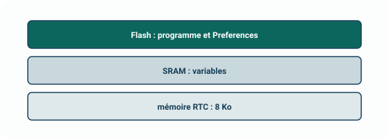
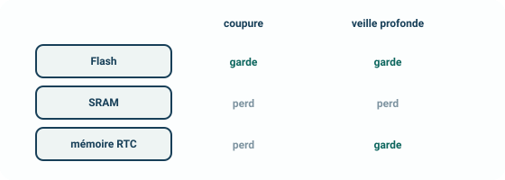

Le module M1 a présenté les mémoires de l'ESP32. Pour un appareil qui doit **se souvenir** (un réglage, un compteur, un maximum), il faut savoir ce que chacune garde, et quand.

- **Flash** : elle contient le programme et une petite zone de stockage, la **NVS**, où la bibliothèque `Preferences` range des réglages. Elle garde tout, même sans courant.
- **SRAM** : les variables ordinaires. Elle perd tout à la coupure, et aussi en **veille profonde**, car la puce y est presque éteinte.
- **Mémoire RTC** : 8 Ko qui restent alimentés pendant la veille profonde, avec l'horloge RTC. Elle perd tout à la coupure.

## Choisir sa mémoire

| Besoin | Mémoire | Outil |
|---|---|---|
| une valeur de travail, perdue au redémarrage sans dommage | SRAM | variable ordinaire |
| un compteur de réveils, tant que la pile tient | mémoire RTC | `RTC_DATA_ATTR` (section 6) |
| un réglage qui doit survivre à une coupure | Flash (NVS) | `Preferences` (section 2) |
| beaucoup de mesures | carte microSD | module M7 |

## À retenir

- Flash : garde tout. SRAM : perd tout à la coupure et en veille profonde. Mémoire RTC : garde en veille profonde.
- `Preferences` pour un réglage durable, `RTC_DATA_ATTR` pour une valeur qui traverse les veilles.
