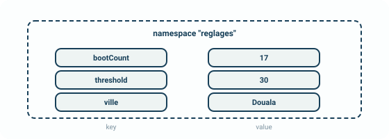

The **Preferences** library stores small values in Flash as **key and value pairs**, grouped in a **namespace**. They survive power-off and the upload of a new program.



## Counting start-ups

```cpp
#include <Arduino.h>
#include <Preferences.h>

Preferences prefs;

void setup() {
  Serial.begin(115200);
  delay(1000);
  // «Espace de noms « reglages », en lecture et écriture|Namespace "reglages", read and write»
  prefs.begin("reglages", false);
  uint32_t starts = prefs.getUInt("starts", 0);  // 0 if the key does not exist yet
  starts++;
  prefs.putUInt("starts", starts);
  prefs.end();
  Serial.printf("Starts since the first upload: %lu\n", (unsigned long)starts);
}

void loop() {
}
```

- `prefs.begin("reglages", false)` opens the namespace (15 characters at most); `false` allows writing.
- `getUInt("starts", 0)` reads the value, or 0 if the key does not exist yet.
- `putUInt("starts", starts)` writes it; `prefs.end()` closes.

Press EN several times, then unplug the board: the count keeps rising.

| Type | Read | Write |
|---|---|---|
| unsigned integer | `getUInt` | `putUInt` |
| integer | `getInt` | `putInt` |
| decimal number | `getFloat` | `putFloat` |
| text | `getString` | `putString` |
| boolean | `getBool` | `putBool` |

## Flash wears out


Each Flash cell withstands a limited number of writes, of the order of 100000. A program that writes at every pass through `loop()` would wear it out in minutes. Rule: write **only if the value has changed**, and never in a loop.

## Key points

- `Preferences`: key and value pairs, in Flash, that survive power-off.
- `begin(namespace, false)`, `get…(key, default)`, `put…(key, value)`, `end()`.
- Write only when the value changes.
