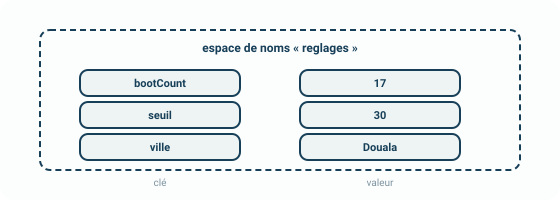

La bibliothèque **Preferences** range de petites valeurs en Flash sous forme de **paires clé et valeur**, regroupées dans un **espace de noms**. Elles survivent à la coupure et au téléversement d'un nouveau programme.



## Compter les démarrages

```cpp
#include <Arduino.h>
#include <Preferences.h>

Preferences prefs;

void setup() {
  Serial.begin(115200);
  delay(1000);
  // «Espace de noms « reglages », en lecture et écriture|Namespace "reglages", read and write»
  prefs.begin("reglages", false);
  uint32_t starts = prefs.getUInt("starts", 0);  // 0 si la clé n'existe pas encore
  starts++;
  prefs.putUInt("starts", starts);
  prefs.end();
  Serial.printf("Démarrages depuis le premier téléversement : %lu\n", (unsigned long)starts);
}

void loop() {
}
```

- `prefs.begin("reglages", false)` ouvre l'espace de noms (au plus 15 caractères) ; `false` autorise l'écriture.
- `getUInt("starts", 0)` lit la valeur, ou 0 si la clé n'existe pas encore.
- `putUInt("starts", starts)` l'écrit ; `prefs.end()` referme.

Appuyez plusieurs fois sur EN, puis débranchez la carte : le compte continue d'augmenter.

| Type | Lire | Écrire |
|---|---|---|
| entier sans signe | `getUInt` | `putUInt` |
| entier | `getInt` | `putInt` |
| nombre à virgule | `getFloat` | `putFloat` |
| texte | `getString` | `putString` |
| booléen | `getBool` | `putBool` |

## La Flash s'use


Chaque cellule de Flash supporte un nombre limité d'écritures, de l'ordre de 100 000. Un programme qui écrit à chaque tour de `loop()` l'userait en quelques minutes. Règle : n'écrire **que si la valeur a changé**, et jamais en boucle.

## À retenir

- `Preferences` : paires clé et valeur, en Flash, qui survivent à la coupure.
- `begin(espace, false)`, `get…(clé, défaut)`, `put…(clé, valeur)`, `end()`.
- Écrire seulement quand la valeur change.
