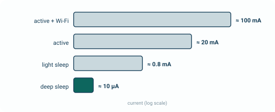
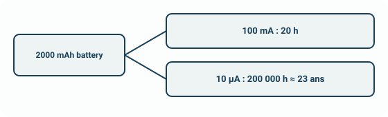

On USB, power consumption hardly matters. On a battery, it decides the autonomy: hours, or years.

## Operating modes

| Mode | What runs | Typical chip current |
|---|---|---|
| active with Wi-Fi | processor and radio | about 100 mA, with peaks towards 250 mA |
| active | processor, radio off | about 20 to 50 mA |
| light sleep | processor paused, SRAM kept | about 0.8 mA |
| deep sleep | RTC clock and RTC memory only | about 10 µA |

These values concern the chip. The DevKit board adds its regulator, its USB-serial bridge and its power LED, which alone draw several milliamps: for real autonomy, a stripped-down circuit is used.

## Working out an autonomy

Autonomy (h) = battery capacity (mAh) / average current (mA).

- 2000 mAh at 100 mA: 20 h.
- 2000 mAh at 0.01 mA: 200000 h, more than 22 years in theory. In practice, the battery's self-discharge limits it long before.

## The average current of a sleeping device

A device that measures for 0.5 s at 50 mA then sleeps for 10 s at 0.01 mA draws on average:

(0.5 × 50 + 10 × 0.01) / 10.5 ≈ 2.4 mA

The share of active time decides almost everything: the measurement must be **short**.

## Key points

- Active with Wi-Fi ≈ 100 mA; deep sleep ≈ 10 µA.
- Autonomy = capacity / average current.
- Average current = sum of (duration × current) / total duration.
