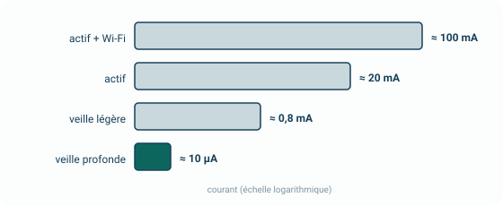
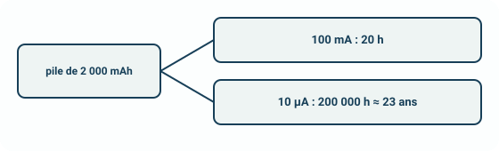

Sur l'USB, la consommation importe peu. Sur une pile, elle décide de l'autonomie : des heures, ou des années.

## Les modes de fonctionnement

| Mode | Ce qui tourne | Courant typique de la puce |
|---|---|---|
| actif avec Wi-Fi | processeur et radio | environ 100 mA, avec des pointes vers 250 mA |
| actif | processeur, radio coupée | environ 20 à 50 mA |
| veille légère | processeur en pause, SRAM gardée | environ 0,8 mA |
| veille profonde | horloge RTC et mémoire RTC seulement | environ 10 µA |

Ces valeurs concernent la puce. La carte DevKit ajoute son régulateur, son pont USB-série et sa LED d'alimentation, qui consomment à eux seuls plusieurs milliampères : pour une vraie autonomie, on utilise un montage dépouillé.

## Calculer une autonomie

Autonomie (h) = capacité de la pile (mAh) / courant moyen (mA).

- 2 000 mAh à 100 mA : 20 h.
- 2 000 mAh à 0,01 mA : 200 000 h, plus de 22 ans en théorie. En pratique, l'autodécharge de la pile limite bien avant.

## Le courant moyen d'un appareil qui dort

Un appareil qui mesure 0,5 s à 50 mA puis dort 10 s à 0,01 mA consomme en moyenne :

(0,5 × 50 + 10 × 0,01) / 10,5 ≈ 2,4 mA

La part du temps actif décide presque de tout : la mesure doit être **courte**.

## À retenir

- Actif avec Wi-Fi ≈ 100 mA ; veille profonde ≈ 10 µA.
- Autonomie = capacité / courant moyen.
- Courant moyen = somme (durée × courant) / durée totale.
