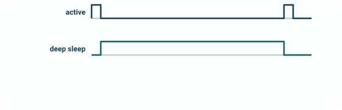
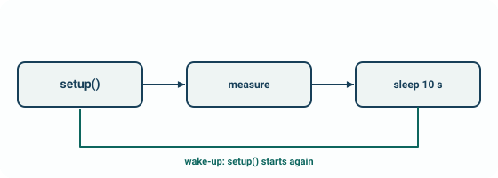

In **deep sleep**, almost the whole chip is switched off: only the RTC clock and the RTC memory stay powered. The **timer** wake-up is the simplest: set a duration, then go to sleep.



## The program

```cpp
#include <Arduino.h>
#include "esp_sleep.h"

const uint8_t LED_PIN = 25;
const uint64_t SLEEP_US = 10ULL * 1000000ULL;  // 10 s in microseconds

void setup() {
  Serial.begin(115200);
  pinMode(LED_PIN, OUTPUT);
  digitalWrite(LED_PIN, HIGH);
  Serial.println("Awake: measuring...");
  delay(500);  // the time of one measurement
  digitalWrite(LED_PIN, LOW);
  esp_sleep_enable_timer_wakeup(SLEEP_US);
  Serial.println("Sleeping for 10 s");
  Serial.flush();
  esp_deep_sleep_start();  // setup() will start again on wake-up
}

void loop() {
  // Never reached: the board goes back to sleep in setup()
}
```

- `esp_sleep_enable_timer_wakeup(duration)` sets the timer, in **microseconds**: 10 s = 10000000 µs. The `ULL` suffix avoids an overflow in the calculation.
- `Serial.flush()` waits until the last characters have left before switching off.
- `esp_deep_sleep_start()` puts the chip to sleep: the next line is never run.

## A wake-up is a restart



On wake-up, the chip **restarts**: `setup()` runs again from the start, ordinary variables are reset to their initial value. So all the work is done in `setup()`, which ends by going back to sleep; `loop()` is never reached.

Consequence: to keep a value from one wake-up to the next, you need the RTC memory (section 6) or `Preferences` (section 2).

## Key points

- Deep sleep: about 10 µA, only the RTC clock and memory stay powered.
- `esp_sleep_enable_timer_wakeup(µs)` then `esp_deep_sleep_start()`.
- Waking up restarts the chip: everything happens in `setup()`.
