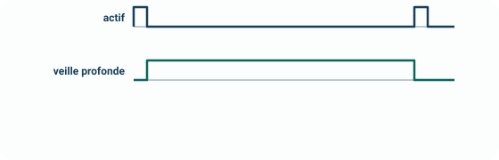
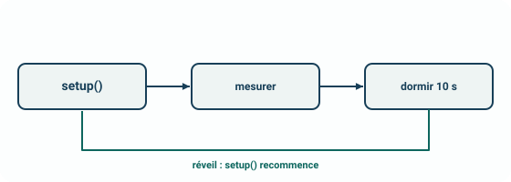

En **veille profonde**, presque toute la puce est coupée : seuls l'horloge RTC et la mémoire RTC restent alimentées. Le réveil par **minuterie** est le plus simple : on règle une durée, puis on s'endort.



## Le programme

```cpp
#include <Arduino.h>
#include "esp_sleep.h"

const uint8_t LED_PIN = 25;
const uint64_t SLEEP_US = 10ULL * 1000000ULL;  // 10 s en microsecondes

void setup() {
  Serial.begin(115200);
  pinMode(LED_PIN, OUTPUT);
  digitalWrite(LED_PIN, HIGH);
  Serial.println("Réveillé : mesure...");
  delay(500);  // le temps d'une mesure
  digitalWrite(LED_PIN, LOW);
  esp_sleep_enable_timer_wakeup(SLEEP_US);
  Serial.println("Je dors 10 s");
  Serial.flush();
  esp_deep_sleep_start();  // setup() recommencera au réveil
}

void loop() {
  // Jamais atteinte : la carte se rendort dans setup()
}
```

- `esp_sleep_enable_timer_wakeup(durée)` règle la minuterie, en **microsecondes** : 10 s = 10 000 000 µs. Le suffixe `ULL` évite un débordement du calcul.
- `Serial.flush()` attend que les derniers caractères soient partis avant de couper.
- `esp_deep_sleep_start()` endort la puce : la ligne suivante n'est jamais exécutée.

## Un réveil, c'est un redémarrage



Au réveil, la puce **redémarre** : `setup()` s'exécute de nouveau depuis le début, les variables ordinaires sont remises à leur valeur initiale. Tout le travail se fait donc dans `setup()`, qui se termine en se rendormant ; `loop()` n'est jamais atteinte.

Conséquence : pour garder une valeur d'un réveil à l'autre, il faut la mémoire RTC (section 6) ou `Preferences` (section 2).

## À retenir

- Veille profonde : environ 10 µA, seules l'horloge et la mémoire RTC restent alimentées.
- `esp_sleep_enable_timer_wakeup(µs)` puis `esp_deep_sleep_start()`.
- Le réveil redémarre la puce : tout se passe dans `setup()`.
