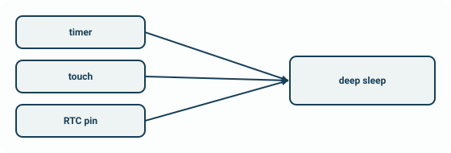
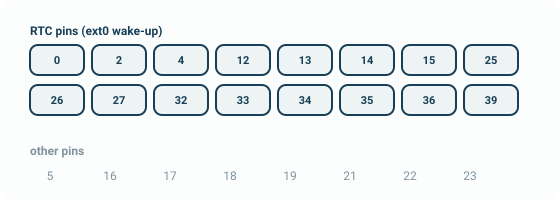

The timer is not the only way out of deep sleep. A device can also wake up when an electrode is touched, or when the level of a pin changes.



## The RTC pins

During deep sleep, only the pins connected to the RTC domain stay watched. They are the ones that can wake the chip by their level (**ext0** wake-up for one pin, **ext1** for several).



For a wake-up button, choose a safe RTC pin: GPIO 25, 26, 27, 32 or 33.

## The program

```cpp
#include <Arduino.h>
#include "esp_sleep.h"
#include "driver/rtc_io.h"

// Button between GPIO 33 (RTC pin) and GND
const gpio_num_t WAKE_BUTTON = GPIO_NUM_33;
const uint8_t TOUCH_PIN = T0;
const uint32_t TOUCH_THRESHOLD = 30;

void setup() {
  Serial.begin(115200);
  delay(500);
  switch (esp_sleep_get_wakeup_cause()) {
    case ESP_SLEEP_WAKEUP_EXT0:     Serial.println("Woken by the button"); break;
    case ESP_SLEEP_WAKEUP_TOUCHPAD: Serial.println("Woken by touch"); break;
    default:                        Serial.println("First start-up"); break;
  }
  // Wake when GPIO 33 goes low; internal pull-up active during sleep
  rtc_gpio_pullup_en(WAKE_BUTTON);
  rtc_gpio_pulldown_dis(WAKE_BUTTON);
  esp_sleep_enable_ext0_wakeup(WAKE_BUTTON, 0);
  touchSleepWakeUpEnable(TOUCH_PIN, TOUCH_THRESHOLD);
  Serial.println("Sleeping: press the button or touch T0");
  Serial.flush();
  esp_deep_sleep_start();
}

void loop() {
}
```

- `esp_sleep_get_wakeup_cause()` tells what woke the chip.
- `esp_sleep_enable_ext0_wakeup(GPIO_NUM_33, 0)`: wake up when GPIO 33 goes **low**. The internal pull-up to 3.3 V must stay active during sleep, hence `rtc_gpio_pullup_en`.
- `touchSleepWakeUpEnable(T0, 30)`: wake up when the touch value drops below the threshold (3.x core).

## Key points

- Possible wake-ups: timer, touch, level of an RTC pin.
- RTC pins: GPIO 0, 2, 4, 12 to 15, 25 to 27, 32 to 39.
- `esp_sleep_get_wakeup_cause()` to know why the chip woke up.
