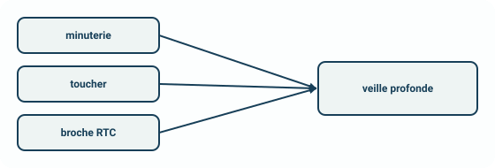
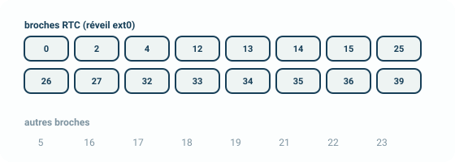

La minuterie n'est pas la seule façon de sortir de la veille profonde. Un appareil peut aussi se réveiller quand on touche une électrode, ou quand le niveau d'une broche change.



## Les broches RTC

Pendant la veille profonde, seules les broches reliées au domaine RTC restent surveillées. Ce sont elles qui peuvent réveiller la puce par leur niveau (réveil **ext0** pour une broche, **ext1** pour plusieurs).



Pour un bouton de réveil, on choisit une broche RTC sûre : GPIO 25, 26, 27, 32 ou 33.

## Le programme

```cpp
#include <Arduino.h>
#include "esp_sleep.h"
#include "driver/rtc_io.h"

// Bouton entre GPIO 33 (broche RTC) et GND
const gpio_num_t WAKE_BUTTON = GPIO_NUM_33;
const uint8_t TOUCH_PIN = T0;
const uint32_t TOUCH_THRESHOLD = 30;

void setup() {
  Serial.begin(115200);
  delay(500);
  switch (esp_sleep_get_wakeup_cause()) {
    case ESP_SLEEP_WAKEUP_EXT0:     Serial.println("Réveil par le bouton"); break;
    case ESP_SLEEP_WAKEUP_TOUCHPAD: Serial.println("Réveil par le toucher"); break;
    default:                        Serial.println("Premier démarrage"); break;
  }
  // Réveil quand GPIO 33 passe au niveau bas ; tirage interne actif pendant le sommeil
  rtc_gpio_pullup_en(WAKE_BUTTON);
  rtc_gpio_pulldown_dis(WAKE_BUTTON);
  esp_sleep_enable_ext0_wakeup(WAKE_BUTTON, 0);
  touchSleepWakeUpEnable(TOUCH_PIN, TOUCH_THRESHOLD);
  Serial.println("Je dors : appuyez sur le bouton ou touchez T0");
  Serial.flush();
  esp_deep_sleep_start();
}

void loop() {
}
```

- `esp_sleep_get_wakeup_cause()` dit ce qui a réveillé la puce.
- `esp_sleep_enable_ext0_wakeup(GPIO_NUM_33, 0)` : réveil quand GPIO 33 passe au niveau **bas**. Le tirage interne vers 3,3 V doit rester actif pendant le sommeil, d'où `rtc_gpio_pullup_en`.
- `touchSleepWakeUpEnable(T0, 30)` : réveil quand la valeur tactile passe sous le seuil (cœur 3.x).

## À retenir

- Réveils possibles : minuterie, toucher, niveau d'une broche RTC.
- Broches RTC : GPIO 0, 2, 4, 12 à 15, 25 à 27, 32 à 39.
- `esp_sleep_get_wakeup_cause()` pour savoir pourquoi on s'est réveillé.
