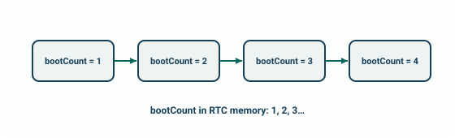
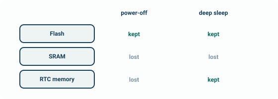

Since a wake-up restarts the chip, an ordinary variable starts from zero every time. To **count wake-ups** without wearing out the Flash, the variable is stored in the **RTC memory**, which stays powered during sleep.

## RTC_DATA_ATTR

```cpp
#include <Arduino.h>
#include "esp_sleep.h"

// Stored in RTC memory: survives deep sleep, not power-off
RTC_DATA_ATTR uint32_t bootCount = 0;
// Ordinary SRAM variable: reset at every wake-up
uint32_t ramCount = 0;

void setup() {
  Serial.begin(115200);
  delay(500);
  bootCount++;
  ramCount++;
  Serial.printf("bootCount = %lu, ramCount = %lu\n", (unsigned long)bootCount, (unsigned long)ramCount);
  esp_sleep_enable_timer_wakeup(5ULL * 1000000ULL);
  Serial.flush();
  esp_deep_sleep_start();
}

void loop() {
}
```

The monitor shows:

```text
bootCount = 1, ramCount = 1
bootCount = 2, ramCount = 1
bootCount = 3, ramCount = 1
```



- `bootCount`, marked `RTC_DATA_ATTR`, keeps its value from one wake-up to the next.
- `ramCount`, an ordinary SRAM variable, starts again from 0 and is always 1.

## The limits

- The RTC memory holds only **8 KB**: a few counters and values, not a log.
- It is **lost at power-off** and when EN is pressed: for a value that must survive everything, use `Preferences`.
- Unlike Flash, it does not wear out: it can be written at every wake-up.



## Key points

- `RTC_DATA_ATTR` places a variable in RTC memory: it crosses deep sleeps.
- 8 KB, lost at power-off or when EN is pressed.
- RTC memory at every wake-up, Flash only for what must survive everything.
