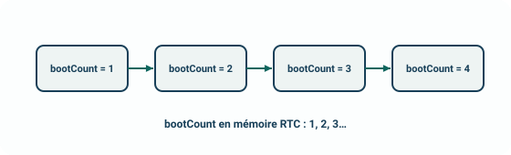

Puisqu'un réveil redémarre la puce, une variable ordinaire repart à zéro à chaque fois. Pour **compter les réveils** sans user la Flash, on range la variable dans la **mémoire RTC**, qui reste alimentée pendant le sommeil.

## RTC_DATA_ATTR

```cpp
#include <Arduino.h>
#include "esp_sleep.h"

// Rangée en mémoire RTC : survit à la veille profonde, pas à la coupure
RTC_DATA_ATTR uint32_t bootCount = 0;
// Variable ordinaire en SRAM : remise à zéro à chaque réveil
uint32_t ramCount = 0;

void setup() {
  Serial.begin(115200);
  delay(500);
  bootCount++;
  ramCount++;
  Serial.printf("bootCount = %lu, ramCount = %lu\n", (unsigned long)bootCount, (unsigned long)ramCount);
  esp_sleep_enable_timer_wakeup(5ULL * 1000000ULL);
  Serial.flush();
  esp_deep_sleep_start();
}

void loop() {
}
```

Le moniteur affiche :

```text
bootCount = 1, ramCount = 1
bootCount = 2, ramCount = 1
bootCount = 3, ramCount = 1
```



- `bootCount`, marquée `RTC_DATA_ATTR`, garde sa valeur d'un réveil à l'autre.
- `ramCount`, variable ordinaire en SRAM, repart de 0 et vaut toujours 1.

## Les limites

- La mémoire RTC ne compte que **8 Ko** : quelques compteurs et valeurs, pas un journal.
- Elle est **perdue à la coupure** et quand on appuie sur EN : pour une valeur qui doit survivre à tout, on utilise `Preferences`.
- Contrairement à la Flash, elle ne s'use pas : on peut y écrire à chaque réveil.


## À retenir

- `RTC_DATA_ATTR` place une variable en mémoire RTC : elle traverse les veilles profondes.
- 8 Ko, perdus à la coupure ou à l'appui sur EN.
- Mémoire RTC à chaque réveil, Flash seulement pour ce qui doit survivre à tout.
