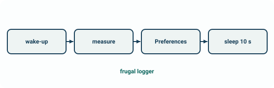

This mini-project builds a **frugal logger**: it wakes up every 10 s, measures the potentiometer voltage, remembers the maximum ever reached, and goes back to sleep.

## Goal

Combine deep sleep, RTC memory and Preferences for a device that draws little and does not forget what matters.

## Safety

- Circuit powered by the computer's USB; no circuit in the course goes above **12 V** DC.
- The potentiometer is supplied by the 3V3 pin, never by the 5V pin.
- Never 5 V on a pin. Wire with the USB cable unplugged.



## Equipment

| Quantity | Item |
|---|---|
| 1 | ESP32 DevKit board, breadboard and wires |
| 1 | 10 kΩ potentiometer, wiper on GPIO 34 |
| 1 | multimeter (milliamp or microamp range) |

## Program

```cpp
#include <Arduino.h>
#include <Preferences.h>
#include "esp_sleep.h"

const uint8_t POT_PIN = 34;
const uint64_t SLEEP_US = 10ULL * 1000000ULL;

RTC_DATA_ATTR uint32_t wakeCount = 0;
Preferences prefs;

void setup() {
  Serial.begin(115200);
  delay(200);
  wakeCount++;
  uint32_t millivolts = analogReadMilliVolts(POT_PIN);
  // The maximum survives even a power-off: it is stored in Flash
  prefs.begin("enregistreur", false);
  uint32_t maxMv = prefs.getUInt("max_mv", 0);
  if (millivolts > maxMv) {
    maxMv = millivolts;
    prefs.putUInt("max_mv", maxMv);  // write only when the value changes
  }
  prefs.end();
  Serial.printf("wake-up %lu: %lu mV, maximum %lu mV\n",
                (unsigned long)wakeCount, (unsigned long)millivolts, (unsigned long)maxMv);
  esp_sleep_enable_timer_wakeup(SLEEP_US);
  Serial.flush();
  esp_deep_sleep_start();
}

void loop() {
}
```

The wake-up counter lives in RTC memory (written at every wake-up, without wearing out the Flash); the maximum lives in Preferences (written only when it changes, and kept even after a power-off).

## Full kit variant

1. Upload, open the monitor and turn the potentiometer between two wake-ups.
2. Unplug the board, plug it back in: the counter starts again from 1, the maximum is still there.
3. On the oscilloscope, across a 1 Ω resistor inserted in the supply wire of a bare board, watch the current peak of each wake-up.

## Multimeter-only variant

1. Same circuit and same program.
2. Write down three successive lines of the monitor.
3. If your board is powered by an external 3.3 V source, insert the multimeter as an ammeter in the supply wire: compare the current during the measurement and during sleep (on a DevKit, the regulator and the USB-serial bridge hide part of the drop).

| Measurement | Expected | Measured |
|---|---|---|
| interval between two lines | 10 s | |
| counter after a power-off | starts again from 1 | |
| maximum after a power-off | kept | |
| current during sleep (bare board) | a few tens of µA | |

## To conclude

Explain why the wake-up counter is stored in RTC memory and the maximum in Preferences, and not the other way round.
