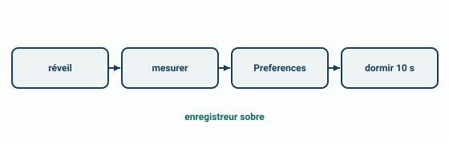

Ce mini-projet construit un **enregistreur sobre** : il se réveille toutes les 10 s, mesure la tension du potentiomètre, retient le maximum jamais atteint, et se rendort.

## Objectif

Combiner veille profonde, mémoire RTC et Preferences pour un appareil qui consomme peu et n'oublie pas l'essentiel.

## Sécurité

- Montage alimenté par l'USB de l'ordinateur ; aucun montage de la formation ne dépasse **12 V** en continu.
- Le potentiomètre est alimenté par la broche 3V3, jamais par la broche 5V.
- Jamais 5 V sur une broche. Câblez câble USB débranché.



## Matériel

| Quantité | Élément |
|---|---|
| 1 | carte DevKit ESP32, plaque d'essai et fils |
| 1 | potentiomètre de 10 kΩ, curseur sur GPIO 34 |
| 1 | multimètre (calibre milliampères ou microampères) |

## Programme

```cpp
#include <Arduino.h>
#include <Preferences.h>
#include "esp_sleep.h"

const uint8_t POT_PIN = 34;
const uint64_t SLEEP_US = 10ULL * 1000000ULL;

RTC_DATA_ATTR uint32_t wakeCount = 0;
Preferences prefs;

void setup() {
  Serial.begin(115200);
  delay(200);
  wakeCount++;
  uint32_t millivolts = analogReadMilliVolts(POT_PIN);
  // Le maximum survit même à une coupure : il est rangé en Flash
  prefs.begin("enregistreur", false);
  uint32_t maxMv = prefs.getUInt("max_mv", 0);
  if (millivolts > maxMv) {
    maxMv = millivolts;
    prefs.putUInt("max_mv", maxMv);  // on n'écrit que si la valeur change
  }
  prefs.end();
  Serial.printf("réveil %lu : %lu mV, maximum %lu mV\n",
                (unsigned long)wakeCount, (unsigned long)millivolts, (unsigned long)maxMv);
  esp_sleep_enable_timer_wakeup(SLEEP_US);
  Serial.flush();
  esp_deep_sleep_start();
}

void loop() {
}
```

Le compteur de réveils vit en mémoire RTC (écrit à chaque réveil, sans user la Flash) ; le maximum vit en Preferences (écrit seulement quand il change, et gardé même après une coupure).

## Variante kit complet

1. Téléversez, ouvrez le moniteur et tournez le potentiomètre entre deux réveils.
2. Débranchez la carte, rebranchez-la : le compteur repart de 1, le maximum est toujours là.
3. À l'oscilloscope, sur une résistance de 1 Ω insérée dans le fil d'alimentation d'une carte nue, observez le pic de courant de chaque réveil.

## Variante multimètre seul

1. Même montage et même programme.
2. Relevez trois lignes successives du moniteur.
3. Si votre carte est alimentée par une source externe en 3,3 V, insérez le multimètre en ampèremètre dans le fil d'alimentation : comparez le courant pendant la mesure et pendant le sommeil (sur une DevKit, le régulateur et le pont USB-série masquent une partie de la baisse).

| Mesure | Attendue | Relevée |
|---|---|---|
| intervalle entre deux lignes | 10 s | |
| compteur après une coupure | repart de 1 | |
| maximum après une coupure | conservé | |
| courant pendant le sommeil (carte nue) | quelques dizaines de µA | |

## Pour conclure

Expliquez pourquoi le compteur de réveils est rangé en mémoire RTC et le maximum en Preferences, et pas l'inverse.
