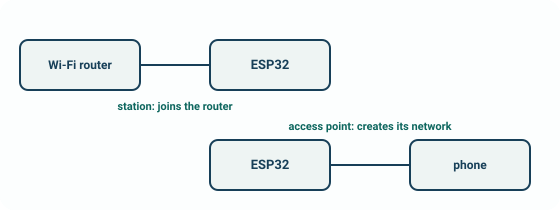
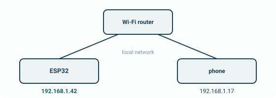

The ESP32 contains a 2.4 GHz **Wi-Fi** radio. It works in two modes, which can also be combined.



- **Station** (`WIFI_STA`): the ESP32 joins an existing network, the router's, as a phone would. It receives an IP address from the router.
- **Access point** (`WIFI_AP`): the ESP32 creates its own network. A phone connects to it directly, without a router: useful on a building site or in a workshop.

## The access point

```cpp
#include <Arduino.h>
#include <WiFi.h>
#include "secrets.h"

void setup() {
  Serial.begin(115200);
  delay(500);
  // Access point mode: the ESP32 creates its own network
  WiFi.mode(WIFI_AP);
  WiFi.softAP(AP_SSID, AP_PASSWORD);
  Serial.print("Network created, board address: ");
  Serial.println(WiFi.softAPIP());  // 192.168.4.1 by default
}

void loop() {
}
```

The network name and password come from the `secrets.h` file (section 6). As an access point, the board takes the address 192.168.4.1; the phone, connected to this network, reaches it at that address.

## The local network



As a station, the router assigns an address to each device of the local network, for example 192.168.1.42 for the ESP32. A phone **on the same network** reaches it by typing that address in its browser.

## Reminder: ADC 2 and Wi-Fi

While Wi-Fi is running, ADC 2 is unavailable (module M6). The analog measurements of this module are made on GPIO 34, on ADC 1.

## Key points

- Station: the ESP32 joins the router. Access point: it creates its network.
- An IP address identifies the board on the local network.
- With Wi-Fi, analog measurements on ADC 1 only.
