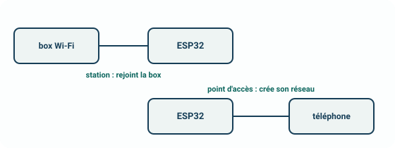
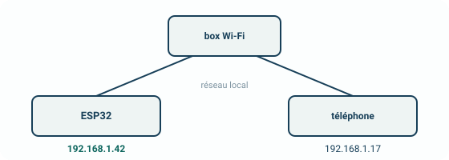

L'ESP32 contient une radio **Wi-Fi** 2,4 GHz. Elle fonctionne selon deux modes, que l'on peut aussi combiner.



- **Station** (`WIFI_STA`) : l'ESP32 rejoint un réseau existant, celui de la box, comme le ferait un téléphone. Il reçoit une adresse IP de la box.
- **Point d'accès** (`WIFI_AP`) : l'ESP32 crée son propre réseau. Un téléphone s'y connecte directement, sans box : utile sur un chantier ou en atelier.

## Le point d'accès

```cpp
#include <Arduino.h>
#include <WiFi.h>
#include "secrets.h"

void setup() {
  Serial.begin(115200);
  delay(500);
  // Mode point d'accès : l'ESP32 crée son propre réseau
  WiFi.mode(WIFI_AP);
  WiFi.softAP(AP_SSID, AP_PASSWORD);
  Serial.print("Réseau créé, adresse de la carte : ");
  Serial.println(WiFi.softAPIP());  // 192.168.4.1 par défaut
}

void loop() {
}
```

Le nom et le mot de passe du réseau viennent du fichier `secrets.h` (section 6). En point d'accès, la carte prend l'adresse 192.168.4.1 ; le téléphone, connecté à ce réseau, l'atteint par cette adresse.

## Le réseau local



En station, la box attribue une adresse à chaque appareil du réseau local, par exemple 192.168.1.42 pour l'ESP32. Un téléphone **sur le même réseau** l'atteint en tapant cette adresse dans son navigateur.

## Rappel : ADC 2 et Wi-Fi

Quand le Wi-Fi fonctionne, l'ADC 2 est indisponible (module M6). Les mesures analogiques de ce module se font sur GPIO 34, sur l'ADC 1.

## À retenir

- Station : l'ESP32 rejoint la box. Point d'accès : il crée son réseau.
- Une adresse IP identifie la carte sur le réseau local.
- Avec le Wi-Fi, mesures analogiques sur l'ADC 1 seulement.
