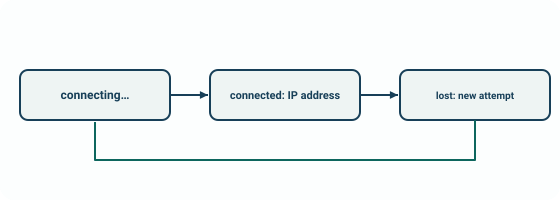
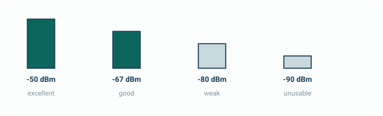

In station mode, connecting takes a few seconds, and the connection can be lost: router restarted, signal too weak. A robust program waits for the connection with a time limit, then **watches** it and restarts it.



```cpp
#include <Arduino.h>
#include <WiFi.h>
#include "secrets.h"

const uint32_t CHECK_MS = 5000;
uint32_t lastCheckMs = 0;

void connectWifi() {
  Serial.print("Connecting");
  WiFi.begin(WIFI_SSID, WIFI_PASSWORD);
  uint32_t startMs = millis();
  while (WiFi.status() != WL_CONNECTED && millis() - startMs < 15000) {
    delay(250);
    Serial.print(".");
  }
  if (WiFi.status() == WL_CONNECTED) {
    Serial.printf("\nConnected: %s, signal %d dBm\n", WiFi.localIP().toString().c_str(), WiFi.RSSI());
  } else {
    Serial.println("\nFailed: will try again later");
  }
}

void setup() {
  Serial.begin(115200);
  WiFi.mode(WIFI_STA);  // station: join the router
  connectWifi();
}

void loop() {
  uint32_t now = millis();
  // Every 5 s, check the connection and restart it if needed
  if (now - lastCheckMs >= CHECK_MS) {
    lastCheckMs = now;
    if (WiFi.status() != WL_CONNECTED) {
      WiFi.disconnect();
      connectWifi();
    }
  }
}
```

## The functions used

- `WiFi.mode(WIFI_STA)` chooses station mode.
- `WiFi.begin(WIFI_SSID, WIFI_PASSWORD)` starts the connection; the credentials come from `secrets.h`.
- `WiFi.status()` is `WL_CONNECTED` once connected.
- `WiFi.localIP()` gives the address received from the router; `WiFi.RSSI()` the signal strength.
- The waiting loop stops after 15 s at most: without this limit, a switched-off router would block the board forever.

## Signal strength



RSSI is negative and expressed in dBm: **the closer to 0, the better the signal**. Below -80 dBm, the link becomes unstable: move the board closer to the router, or put nothing in front of the module's printed antenna.

## Key points

- `WiFi.begin` then wait for `WL_CONNECTED`, with a time limit.
- Watch the connection with `millis()` and restart it if it drops.
- RSSI: -50 dBm excellent, -80 dBm weak.
