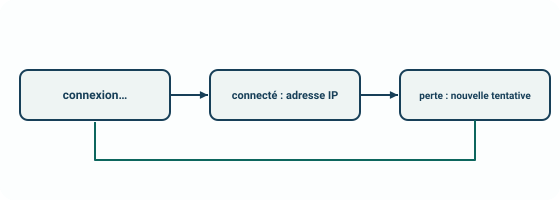
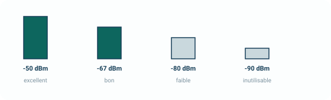

En mode station, se connecter prend quelques secondes, et la connexion peut se perdre : box redémarrée, signal trop faible. Un programme robuste attend la connexion avec une limite de temps, puis la **surveille** et la relance.



```cpp
#include <Arduino.h>
#include <WiFi.h>
#include "secrets.h"

const uint32_t CHECK_MS = 5000;
uint32_t lastCheckMs = 0;

void connectWifi() {
  Serial.print("Connexion");
  WiFi.begin(WIFI_SSID, WIFI_PASSWORD);
  uint32_t startMs = millis();
  while (WiFi.status() != WL_CONNECTED && millis() - startMs < 15000) {
    delay(250);
    Serial.print(".");
  }
  if (WiFi.status() == WL_CONNECTED) {
    Serial.printf("\nConnecté : %s, signal %d dBm\n", WiFi.localIP().toString().c_str(), WiFi.RSSI());
  } else {
    Serial.println("\nÉchec : nouvelle tentative plus tard");
  }
}

void setup() {
  Serial.begin(115200);
  WiFi.mode(WIFI_STA);  // station : rejoindre la box
  connectWifi();
}

void loop() {
  uint32_t now = millis();
  // Toutes les 5 s, on vérifie la connexion et on la relance si besoin
  if (now - lastCheckMs >= CHECK_MS) {
    lastCheckMs = now;
    if (WiFi.status() != WL_CONNECTED) {
      WiFi.disconnect();
      connectWifi();
    }
  }
}
```

## Les fonctions utilisées

- `WiFi.mode(WIFI_STA)` choisit le mode station.
- `WiFi.begin(WIFI_SSID, WIFI_PASSWORD)` lance la connexion ; les identifiants viennent de `secrets.h`.
- `WiFi.status()` vaut `WL_CONNECTED` une fois connecté.
- `WiFi.localIP()` donne l'adresse reçue de la box ; `WiFi.RSSI()` la force du signal.
- La boucle d'attente s'arrête après 15 s au plus : sans cette limite, une box éteinte bloquerait la carte pour toujours.

## La force du signal



Le RSSI est négatif et s'exprime en dBm : **plus il est proche de 0, meilleur est le signal**. En dessous de -80 dBm, la liaison devient instable : rapprocher la carte de la box, ou ne rien poser devant l'antenne imprimée du module.

## À retenir

- `WiFi.begin` puis attente de `WL_CONNECTED`, avec une limite de temps.
- Surveiller la connexion avec `millis()` et la relancer si elle tombe.
- RSSI : -50 dBm excellent, -80 dBm faible.
