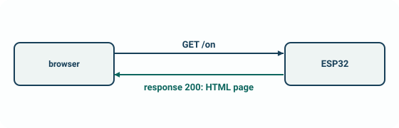
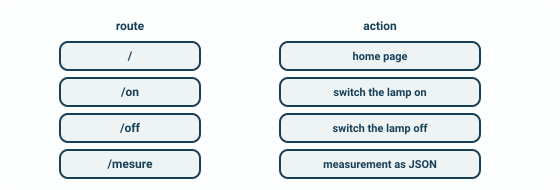

A **web server** waits for requests from browsers and answers them. On the ESP32, the `WebServer` library provides a very simple one.



## Request, route, response

1. The browser sends a **request** for an address, for example `http://192.168.1.42/`.
2. The server looks for the **route** matching the path (here `/`) and calls its function.
3. The function sends back a **response**: a code (200 = success, 404 = not found), a content type and the content itself.

## The program

```cpp
#include <Arduino.h>
#include <WiFi.h>
#include <WebServer.h>
#include "secrets.h"

WebServer server(80);

void handleRoot() {
  server.send(200, "text/html; charset=utf-8", "<h1>Hello from the ESP32</h1>");
}

void handleNotFound() {
  server.send(404, "text/plain; charset=utf-8", "Page not found");
}

void setup() {
  Serial.begin(115200);
  WiFi.mode(WIFI_STA);
  WiFi.begin(WIFI_SSID, WIFI_PASSWORD);
  while (WiFi.status() != WL_CONNECTED) {
    delay(250);
  }
  // Each route is connected to its function
  server.on("/", handleRoot);
  server.onNotFound(handleNotFound);
  server.begin();
  Serial.printf("Open http://%s/\n", WiFi.localIP().toString().c_str());
}

void loop() {
  server.handleClient();  // handles the received requests, without blocking
}
```

- `WebServer server(80)`: a server on port 80, the web port.
- `server.on("/", handleRoot)` connects the `/` route to its function; `onNotFound` handles unknown paths.
- `server.send(200, "text/html; charset=utf-8", ...)` sends the response; `charset=utf-8` displays accented characters correctly.
- `server.handleClient()`, called at every pass through `loop()`, handles the received requests **without blocking**.



## Key points

- Request → route → function → response (code, type, content).
- `server.on(path, function)`, then `server.begin()`.
- `server.handleClient()` at every pass through `loop()`, so no long `delay`.
