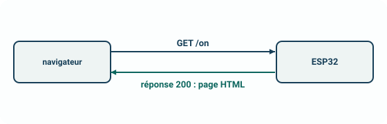
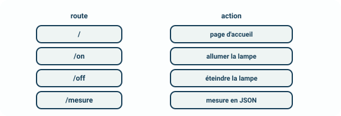

Un **serveur web** attend les requêtes des navigateurs et leur répond. Sur l'ESP32, la bibliothèque `WebServer` en fournit un, très simple.



## Requête, route, réponse

1. Le navigateur envoie une **requête** pour une adresse, par exemple `http://192.168.1.42/`.
2. Le serveur cherche la **route** correspondant au chemin (ici `/`) et appelle sa fonction.
3. La fonction renvoie une **réponse** : un code (200 = réussi, 404 = introuvable), un type de contenu et le contenu lui-même.

## Le programme

```cpp
#include <Arduino.h>
#include <WiFi.h>
#include <WebServer.h>
#include "secrets.h"

WebServer server(80);

void handleRoot() {
  server.send(200, "text/html; charset=utf-8", "<h1>Bonjour depuis l'ESP32</h1>");
}

void handleNotFound() {
  server.send(404, "text/plain; charset=utf-8", "Page introuvable");
}

void setup() {
  Serial.begin(115200);
  WiFi.mode(WIFI_STA);
  WiFi.begin(WIFI_SSID, WIFI_PASSWORD);
  while (WiFi.status() != WL_CONNECTED) {
    delay(250);
  }
  // Chaque route est reliée à sa fonction
  server.on("/", handleRoot);
  server.onNotFound(handleNotFound);
  server.begin();
  Serial.printf("Ouvrez http://%s/\n", WiFi.localIP().toString().c_str());
}

void loop() {
  server.handleClient();  // traite les requêtes reçues, sans bloquer
}
```

- `WebServer server(80)` : un serveur sur le port 80, celui du web.
- `server.on("/", handleRoot)` relie la route `/` à sa fonction ; `onNotFound` traite les chemins inconnus.
- `server.send(200, "text/html; charset=utf-8", ...)` envoie la réponse ; `charset=utf-8` fait afficher correctement les accents.
- `server.handleClient()`, appelée à chaque tour de `loop()`, traite les requêtes reçues **sans bloquer**.



## À retenir

- Requête → route → fonction → réponse (code, type, contenu).
- `server.on(chemin, fonction)`, puis `server.begin()`.
- `server.handleClient()` à chaque tour de `loop()`, donc aucun `delay` long.
