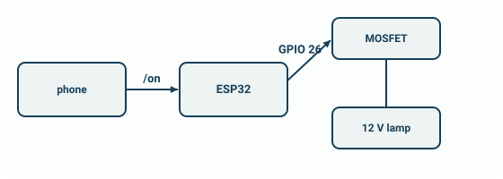
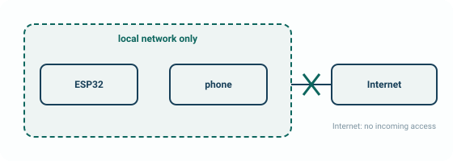

A route can **act**: `/on` switches on the 12 V lamp of module M2, `/off` switches it off. The phone becomes a remote control.



The power wiring does not change: logic-level MOSFET, 220 Ω on the gate, 10 kΩ pull-down, common ground, 12 V supply from a wall adapter. Only the way the pin is driven changes.

```cpp
#include <Arduino.h>
#include <WiFi.h>
#include <WebServer.h>
#include "secrets.h"

// Gate of the 12 V lamp MOSFET (220 ohms, 10 kohm pull-down)
const uint8_t LAMP_PIN = 26;

WebServer server(80);

void handleOn() {
  digitalWrite(LAMP_PIN, HIGH);
  server.send(200, "text/plain; charset=utf-8", "lamp on");
}

void handleOff() {
  digitalWrite(LAMP_PIN, LOW);
  server.send(200, "text/plain; charset=utf-8", "lamp off");
}

void setup() {
  Serial.begin(115200);
  pinMode(LAMP_PIN, OUTPUT);
  digitalWrite(LAMP_PIN, LOW);
  WiFi.mode(WIFI_STA);
  WiFi.begin(WIFI_SSID, WIFI_PASSWORD);
  while (WiFi.status() != WL_CONNECTED) {
    delay(250);
  }
  server.on("/on", handleOn);
  server.on("/off", handleOff);
  server.begin();
  Serial.println(WiFi.localIP());
}

void loop() {
  server.handleClient();
}
```

## What each route does

| Route | Function | Effect |
|---|---|---|
| `/on` | `handleOn` | GPIO 26 high: lamp on |
| `/off` | `handleOff` | GPIO 26 low: lamp off |

Try them by typing `http://<address>/on` then `http://<address>/off` in the phone's browser.

## Starting safely

The lamp is off at start-up (`digitalWrite(LAMP_PIN, LOW)` in `setup()`, and the pull-down resistor during boot): a power cut never switches it back on by itself.



## Key points

- A route can act on an output: `/on`, `/off`.
- The power wiring of module M2 stays the same.
- The output is off at start-up.
