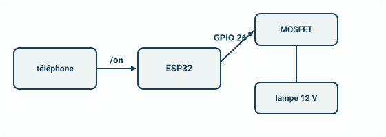
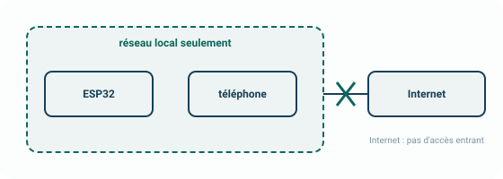

Une route peut **agir** : `/on` allume la lampe 12 V du module M2, `/off` l'éteint. Le téléphone devient une télécommande.



Le câblage de puissance ne change pas : MOSFET logic-level, 220 Ω sur la grille, 10 kΩ de rappel, masse commune, alimentation 12 V par adaptateur mural. Seule la façon de commander la broche change.

```cpp
#include <Arduino.h>
#include <WiFi.h>
#include <WebServer.h>
#include "secrets.h"

// Grille du MOSFET de la lampe 12 V (220 ohms, rappel 10 kohms)
const uint8_t LAMP_PIN = 26;

WebServer server(80);

void handleOn() {
  digitalWrite(LAMP_PIN, HIGH);
  server.send(200, "text/plain; charset=utf-8", "lampe allumée");
}

void handleOff() {
  digitalWrite(LAMP_PIN, LOW);
  server.send(200, "text/plain; charset=utf-8", "lampe éteinte");
}

void setup() {
  Serial.begin(115200);
  pinMode(LAMP_PIN, OUTPUT);
  digitalWrite(LAMP_PIN, LOW);
  WiFi.mode(WIFI_STA);
  WiFi.begin(WIFI_SSID, WIFI_PASSWORD);
  while (WiFi.status() != WL_CONNECTED) {
    delay(250);
  }
  server.on("/on", handleOn);
  server.on("/off", handleOff);
  server.begin();
  Serial.println(WiFi.localIP());
}

void loop() {
  server.handleClient();
}
```

## Ce que fait chaque route

| Route | Fonction | Effet |
|---|---|---|
| `/on` | `handleOn` | GPIO 26 au niveau haut : lampe allumée |
| `/off` | `handleOff` | GPIO 26 au niveau bas : lampe éteinte |

Essayez-les en tapant `http://<adresse>/on` puis `http://<adresse>/off` dans le navigateur du téléphone.

## Bien commencer

La lampe est éteinte au démarrage (`digitalWrite(LAMP_PIN, LOW)` dans `setup()`, et la résistance de rappel pendant le démarrage) : une coupure de courant ne la rallume jamais toute seule.



## À retenir

- Une route peut agir sur une sortie : `/on`, `/off`.
- Le câblage de puissance du module M2 reste le même.
- La sortie est éteinte au démarrage.
