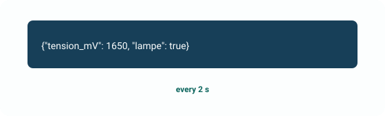
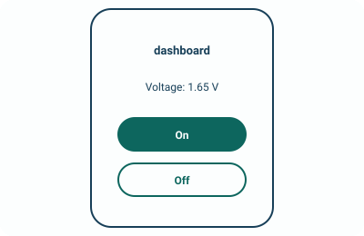

To show a measurement on the phone, the server sends it back in **JSON** format: a text of name and value pairs between braces, which the page can read again.



```cpp
#include <Arduino.h>
#include <WiFi.h>
#include <WebServer.h>
#include "secrets.h"

const uint8_t POT_PIN = 34;

WebServer server(80);

void handleMeasure() {
  uint32_t millivolts = analogReadMilliVolts(POT_PIN);
  // A JSON text: name and value pairs between braces
  String json = "{\"tension_mV\": " + String(millivolts) + "}";
  server.send(200, "application/json", json);
}

void setup() {
  Serial.begin(115200);
  WiFi.mode(WIFI_STA);
  WiFi.begin(WIFI_SSID, WIFI_PASSWORD);
  while (WiFi.status() != WL_CONNECTED) {
    delay(250);
  }
  server.on("/mesure", handleMeasure);
  server.begin();
  Serial.println(WiFi.localIP());
}

void loop() {
  server.handleClient();
}
```

Open `http://<address>/mesure`: the browser shows `{"tension_mV": 1650}`. The `application/json` type tells the browser this is data, not a page.

## Why JSON

- The text is readable by a person **and** by a program.
- The mini-project page reads `/mesure` again every 2 s and updates a single number, without reloading the whole page.
- A value is added by adding a pair: `{"tension_mV": 1650, "lampe": true}`.

## Building the text

The program assembles the text with `String`: `"{\"tension_mV\": " + String(millivolts) + "}"`. JSON quotes are written `\"` in a C++ string. A function that returns the measurement must stay **fast**: `handleClient()` waits until it has finished.



## Key points

- JSON: name and value pairs between braces.
- Response with the `application/json` type.
- Quotes are written `\"` in a C++ string.
