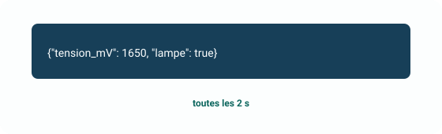
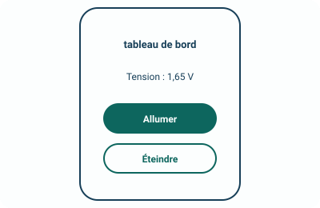

Pour afficher une mesure sur le téléphone, le serveur la renvoie au format **JSON** : un texte de paires nom et valeur entre accolades, que la page sait relire.



```cpp
#include <Arduino.h>
#include <WiFi.h>
#include <WebServer.h>
#include "secrets.h"

const uint8_t POT_PIN = 34;

WebServer server(80);

void handleMeasure() {
  uint32_t millivolts = analogReadMilliVolts(POT_PIN);
  // Un texte JSON : des paires nom et valeur entre accolades
  String json = "{\"tension_mV\": " + String(millivolts) + "}";
  server.send(200, "application/json", json);
}

void setup() {
  Serial.begin(115200);
  WiFi.mode(WIFI_STA);
  WiFi.begin(WIFI_SSID, WIFI_PASSWORD);
  while (WiFi.status() != WL_CONNECTED) {
    delay(250);
  }
  server.on("/mesure", handleMeasure);
  server.begin();
  Serial.println(WiFi.localIP());
}

void loop() {
  server.handleClient();
}
```

Ouvrez `http://<adresse>/mesure` : le navigateur affiche `{"tension_mV": 1650}`. Le type `application/json` dit au navigateur qu'il s'agit de données, pas d'une page.

## Pourquoi du JSON

- Le texte est lisible par une personne **et** par un programme.
- La page du mini-projet relit `/mesure` toutes les 2 s et met à jour un seul nombre, sans recharger toute la page.
- On ajoute une valeur en ajoutant une paire : `{"tension_mV": 1650, "lampe": true}`.

## Construire le texte

Le programme assemble le texte avec `String` : `"{\"tension_mV\": " + String(millivolts) + "}"`. Les guillemets du JSON s'écrivent `\"` dans une chaîne C++. Une fonction qui renvoie la mesure doit rester **rapide** : `handleClient()` attend qu'elle ait fini.



## À retenir

- JSON : paires nom et valeur entre accolades.
- Réponse au type `application/json`.
- Les guillemets s'écrivent `\"` dans une chaîne C++.
