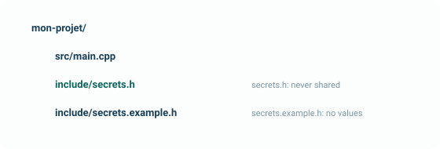
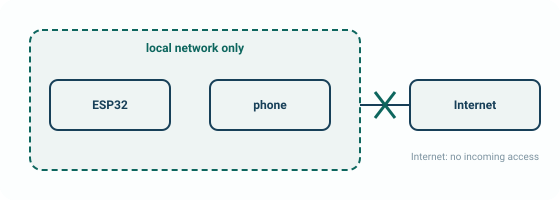

A connected device opens a door. Two simple rules limit the risks.

## Rule 1: secrets stay out of the program

The network name and password are **never** written in `main.cpp`. They live in a separate file, `include/secrets.h`, which is never shared (not on a forum, not in a code repository, not in a screenshot).



The program simply includes it:

```cpp
#include <Arduino.h>
#include <WiFi.h>
#include "secrets.h"
```

A `secrets.example.h` file, without real values, comes with each program of the course: copy it to `secrets.h` and fill it in.

```text
#define WIFI_SSID "network-name"
#define WIFI_PASSWORD "password"
```

## Rule 2: the server stays on the local network



The course's small server has neither password nor encryption: anyone on the network can call `/on`. So it stays on the **local network**: no port forwarding on the router, no access from the Internet. Controlling a load from outside would require authentication and encryption, beyond the scope of this module.

## Key points

- Credentials in `secrets.h`, never in the program nor in anything shared.
- An example without values, `secrets.example.h`, shows the form.
- Server on the local network only.
