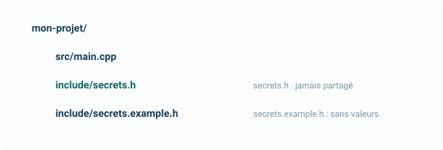
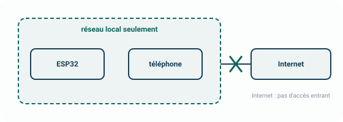

Un appareil connecté ouvre une porte. Deux règles simples en limitent les risques.

## Règle 1 : les secrets restent hors du programme

Le nom et le mot de passe du réseau ne s'écrivent **jamais** dans `main.cpp`. Ils vivent dans un fichier à part, `include/secrets.h`, que l'on ne partage pas (ni sur un forum, ni dans un dépôt de code, ni en capture d'écran).



Le programme l'inclut simplement :

```cpp
#include <Arduino.h>
#include <WiFi.h>
#include "secrets.h"
```

Un fichier `secrets.example.h`, sans vraies valeurs, accompagne chaque programme du cours : copiez-le en `secrets.h` et remplissez-le.

```text
#define WIFI_SSID "nom-du-reseau"
#define WIFI_PASSWORD "mot-de-passe"
```

## Règle 2 : le serveur reste sur le réseau local



Le petit serveur de la formation n'a ni mot de passe ni chiffrement : n'importe qui sur le réseau peut appeler `/on`. On le garde donc sur le **réseau local** : aucune redirection de port sur la box, aucun accès depuis Internet. Commander une charge depuis l'extérieur demanderait une authentification et un chiffrement, hors du cadre de ce module.

## À retenir

- Identifiants dans `secrets.h`, jamais dans le programme ni dans un partage.
- Un exemple sans valeurs, `secrets.example.h`, montre la forme.
- Serveur sur le réseau local seulement.
