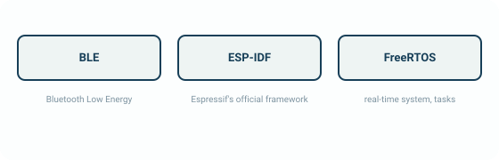
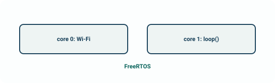

The course stops here, but the ESP32 goes much further. Three paths to carry on.



## Bluetooth Low Energy (BLE)

The ESP32 also speaks **BLE**, designed to exchange small amounts of data while drawing very little: a sensor sending its temperature to a phone app, a watch. The Arduino core provides the `BLE` library.

## ESP-IDF

Module M2 showed `gpio_set_level`, a function of **ESP-IDF**, Espressif's official development framework. Arduino is built on it. Programming directly in ESP-IDF gives access to every option of the chip, at the cost of longer code.

## FreeRTOS



Under the hood, the ESP32 runs **FreeRTOS**, a real-time system that runs several **tasks** at once, on its two cores. `loop()` is already a task. Others can be created:

```cpp
#include <Arduino.h>

const uint8_t LED_PIN = 25;

// A FreeRTOS task: an endless loop that hands back control with vTaskDelay
void blinkTask(void *parameter) {
  pinMode(LED_PIN, OUTPUT);
  for (;;) {
    digitalWrite(LED_PIN, !digitalRead(LED_PIN));
    vTaskDelay(pdMS_TO_TICKS(250));
  }
}

void setup() {
  Serial.begin(115200);
  // Name, stack size, parameter, priority, handle, core
  xTaskCreatePinnedToCore(blinkTask, "blink", 2048, nullptr, 1, nullptr, 0);
}

void loop() {
  // loop() runs on its own, on core 1
  Serial.printf("loop on core %d\n", xPortGetCoreID());
  delay(1000);
}
```

`xTaskCreatePinnedToCore` creates a task on a chosen core; `vTaskDelay` pauses it **without blocking** the other tasks, unlike a `delay` in a single loop. It is another answer to the problem of module M4: doing several things at once.

## Key points

- BLE to exchange little data while drawing little.
- ESP-IDF: the official framework, under Arduino.
- FreeRTOS: several tasks in parallel, `loop()` is one of them.
