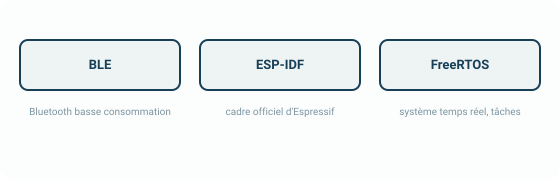
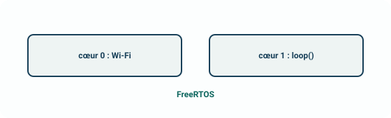

La formation s'arrête ici, mais l'ESP32 va bien plus loin. Trois pistes pour continuer.



## Le Bluetooth basse consommation (BLE)

L'ESP32 parle aussi le **BLE**, conçu pour échanger de petites quantités de données en consommant très peu : un capteur qui envoie sa température à une application de téléphone, une montre. Le cœur Arduino fournit la bibliothèque `BLE`.

## ESP-IDF

Le module M2 a montré `gpio_set_level`, une fonction d'**ESP-IDF**, le cadre de développement officiel d'Espressif. Arduino s'appuie dessus. Programmer directement en ESP-IDF donne accès à toutes les options de la puce, au prix d'un code plus long.

## FreeRTOS



Sous le capot, l'ESP32 exécute **FreeRTOS**, un système temps réel qui fait tourner plusieurs **tâches** à la fois, sur ses deux cœurs. `loop()` est déjà une tâche. On peut en créer d'autres :

```cpp
#include <Arduino.h>

const uint8_t LED_PIN = 25;

// Une tâche FreeRTOS : une boucle sans fin qui rend la main par vTaskDelay
void blinkTask(void *parameter) {
  pinMode(LED_PIN, OUTPUT);
  for (;;) {
    digitalWrite(LED_PIN, !digitalRead(LED_PIN));
    vTaskDelay(pdMS_TO_TICKS(250));
  }
}

void setup() {
  Serial.begin(115200);
  // Nom, taille de pile, paramètre, priorité, poignée, cœur
  xTaskCreatePinnedToCore(blinkTask, "blink", 2048, nullptr, 1, nullptr, 0);
}

void loop() {
  // loop() tourne de son côté, sur le cœur 1
  Serial.printf("loop sur le cœur %d\n", xPortGetCoreID());
  delay(1000);
}
```

`xTaskCreatePinnedToCore` crée une tâche sur un cœur choisi ; `vTaskDelay` la met en pause **sans bloquer** les autres tâches, contrairement à un `delay` dans une boucle unique. C'est une autre réponse au problème du module M4 : faire plusieurs choses à la fois.

## À retenir

- BLE pour échanger peu de données en consommant peu.
- ESP-IDF : le cadre officiel, sous Arduino.
- FreeRTOS : plusieurs tâches en parallèle, `loop()` en est une.
