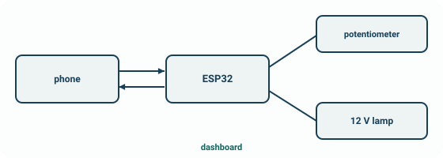

This last mini-project brings the course together: a **web dashboard** that shows the potentiometer voltage live and controls the 12 V lamp from a phone.

## Goal

Serve a web page, a measurement route in JSON and two control routes, on the local network.

## Safety

- The power circuit never goes above **12 V** DC, supplied by a **wall adapter** from 230 V to 12 V; never work on the 230 V side.
- Never 5 V nor 12 V on an ESP32 pin; common ground between the ESP32 and the 12 V supply.
- Wi-Fi credentials in `secrets.h` only; server on the local network, without port forwarding.
- Wire with the power off: USB cable and adapter unplugged.



## Equipment

| Quantity | Item |
|---|---|
| 1 | ESP32 DevKit board, breadboard and wires |
| 1 | 10 kΩ potentiometer, wiper on GPIO 34 |
| 1 | logic-level MOSFET, 220 Ω and 10 kΩ resistors, on GPIO 26 |
| 1 | 12 V lamp or LED strip, 230 V to 12 V wall adapter |
| 1 | phone on the same Wi-Fi network, multimeter |

## Program

```cpp
#include <Arduino.h>
#include <WiFi.h>
#include <WebServer.h>
#include "secrets.h"

const uint8_t POT_PIN = 34;
const uint8_t LAMP_PIN = 26;

WebServer server(80);
bool lampOn = false;

// The page reads /mesure again every 2 s, without reloading
const char *PAGE =
  "<!doctype html><html><head><meta charset=\"utf-8\">"
  "<meta name=\"viewport\" content=\"width=device-width\">"
  "<title>ESP32</title></head><body style=\"font-family:sans-serif;text-align:center\">"
  "<h1>Dashboard</h1><p>Voltage : <b id=\"v\">-</b> mV</p>"
  "<p><button onclick=\"fetch('/on')\">On</button> "
  "<button onclick=\"fetch('/off')\">Off</button></p>"
  "<script>setInterval(function(){fetch('/mesure').then(r=>r.json())"
  ".then(d=>{document.getElementById('v').textContent=d.tension_mV;});},2000);</script>"
  "</body></html>";

void handleRoot() {
  server.send(200, "text/html; charset=utf-8", PAGE);
}

void handleMeasure() {
  String json = "{\"tension_mV\": " + String(analogReadMilliVolts(POT_PIN)) + ", \"lampe\": " + (lampOn ? "true" : "false") + "}";
  server.send(200, "application/json", json);
}

void handleOn() {
  lampOn = true;
  digitalWrite(LAMP_PIN, HIGH);
  server.send(200, "text/plain", "ok");
}

void handleOff() {
  lampOn = false;
  digitalWrite(LAMP_PIN, LOW);
  server.send(200, "text/plain", "ok");
}

void setup() {
  Serial.begin(115200);
  pinMode(LAMP_PIN, OUTPUT);
  digitalWrite(LAMP_PIN, LOW);
  WiFi.mode(WIFI_STA);
  WiFi.begin(WIFI_SSID, WIFI_PASSWORD);
  while (WiFi.status() != WL_CONNECTED) {
    delay(250);
  }
  server.on("/", handleRoot);
  server.on("/mesure", handleMeasure);
  server.on("/on", handleOn);
  server.on("/off", handleOff);
  server.begin();
  Serial.printf("Dashboard: http://%s/\n", WiFi.localIP().toString().c_str());
}

void loop() {
  server.handleClient();
}
```

The page is an HTML text stored in the `PAGE` constant. Its small script reads `/mesure` again every 2 s; the buttons call `/on` and `/off`.

## Full kit variant

1. Fill in `secrets.h`, wire, upload; note the address shown in the monitor.
2. Open it on the phone; turn the potentiometer and watch the value change.
3. On the oscilloscope on the MOSFET gate (GPIO 26), measure the delay between pressing a button and the level change.

## Multimeter-only variant

1. Same circuit and same program.
2. For three potentiometer positions, compare the voltage measured on GPIO 34 with the value shown.
3. Measure the voltage across the lamp after "On", then "Off".

| Measurement | Expected | Measured |
|---|---|---|
| wiper in the middle: multimeter / page | about 1650 mV, both | |
| lamp after "On" | almost 12 V | |
| lamp after "Off" | 0 V | |
| value refresh | every 2 s | |

## To conclude

Explain why `loop()` contains a single line, and what would happen if a `delay(5000)` were added to it.
