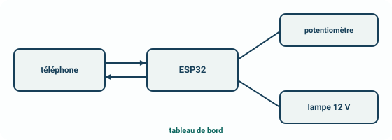

Ce dernier mini-projet réunit la formation : un **tableau de bord web** qui affiche la tension du potentiomètre en direct et commande la lampe 12 V depuis un téléphone.

## Objectif

Servir une page web, une route de mesure en JSON et deux routes de commande, sur le réseau local.

## Sécurité

- Le circuit de puissance ne dépasse jamais **12 V** en continu, fourni par un **adaptateur mural** 230 V vers 12 V ; on ne travaille jamais côté 230 V.
- Jamais 5 V ni 12 V sur une broche de l'ESP32 ; masse commune entre l'ESP32 et l'alimentation 12 V.
- Identifiants Wi-Fi dans `secrets.h` seulement ; serveur sur le réseau local, sans redirection de port.
- Câblez hors tension : câble USB et adaptateur débranchés.



## Matériel

| Quantité | Élément |
|---|---|
| 1 | carte DevKit ESP32, plaque d'essai et fils |
| 1 | potentiomètre de 10 kΩ, curseur sur GPIO 34 |
| 1 | MOSFET logic-level, résistances de 220 Ω et 10 kΩ, sur GPIO 26 |
| 1 | lampe ou ruban de LED 12 V, adaptateur mural 230 V vers 12 V |
| 1 | téléphone sur le même réseau Wi-Fi, multimètre |

## Programme

```cpp
#include <Arduino.h>
#include <WiFi.h>
#include <WebServer.h>
#include "secrets.h"

const uint8_t POT_PIN = 34;
const uint8_t LAMP_PIN = 26;

WebServer server(80);
bool lampOn = false;

// La page relit /mesure toutes les 2 s, sans se recharger
const char *PAGE =
  "<!doctype html><html><head><meta charset=\"utf-8\">"
  "<meta name=\"viewport\" content=\"width=device-width\">"
  "<title>ESP32</title></head><body style=\"font-family:sans-serif;text-align:center\">"
  "<h1>Tableau de bord</h1><p>Tension : <b id=\"v\">-</b> mV</p>"
  "<p><button onclick=\"fetch('/on')\">Allumer</button> "
  "<button onclick=\"fetch('/off')\">Éteindre</button></p>"
  "<script>setInterval(function(){fetch('/mesure').then(r=>r.json())"
  ".then(d=>{document.getElementById('v').textContent=d.tension_mV;});},2000);</script>"
  "</body></html>";

void handleRoot() {
  server.send(200, "text/html; charset=utf-8", PAGE);
}

void handleMeasure() {
  String json = "{\"tension_mV\": " + String(analogReadMilliVolts(POT_PIN)) + ", \"lampe\": " + (lampOn ? "true" : "false") + "}";
  server.send(200, "application/json", json);
}

void handleOn() {
  lampOn = true;
  digitalWrite(LAMP_PIN, HIGH);
  server.send(200, "text/plain", "ok");
}

void handleOff() {
  lampOn = false;
  digitalWrite(LAMP_PIN, LOW);
  server.send(200, "text/plain", "ok");
}

void setup() {
  Serial.begin(115200);
  pinMode(LAMP_PIN, OUTPUT);
  digitalWrite(LAMP_PIN, LOW);
  WiFi.mode(WIFI_STA);
  WiFi.begin(WIFI_SSID, WIFI_PASSWORD);
  while (WiFi.status() != WL_CONNECTED) {
    delay(250);
  }
  server.on("/", handleRoot);
  server.on("/mesure", handleMeasure);
  server.on("/on", handleOn);
  server.on("/off", handleOff);
  server.begin();
  Serial.printf("Tableau de bord : http://%s/\n", WiFi.localIP().toString().c_str());
}

void loop() {
  server.handleClient();
}
```

La page est un texte HTML rangé dans la constante `PAGE`. Son petit script relit `/mesure` toutes les 2 s ; les boutons appellent `/on` et `/off`.

## Variante kit complet

1. Remplissez `secrets.h`, câblez, téléversez ; notez l'adresse affichée dans le moniteur.
2. Ouvrez-la sur le téléphone ; tournez le potentiomètre et regardez la valeur changer.
3. À l'oscilloscope sur la grille du MOSFET (GPIO 26), mesurez le délai entre l'appui sur un bouton et le changement de niveau.

## Variante multimètre seul

1. Même montage et même programme.
2. Pour trois positions du potentiomètre, comparez la tension mesurée sur GPIO 34 et la valeur affichée.
3. Mesurez la tension aux bornes de la lampe après « Allumer », puis « Éteindre ».

| Mesure | Attendue | Relevée |
|---|---|---|
| curseur au milieu : multimètre / page | 1 650 mV environ, les deux | |
| lampe après « Allumer » | presque 12 V | |
| lampe après « Éteindre » | 0 V | |
| rafraîchissement de la valeur | toutes les 2 s | |

## Pour conclure

Expliquez pourquoi `loop()` ne contient qu'une seule ligne, et ce qui se passerait si l'on y ajoutait un `delay(5000)`.
